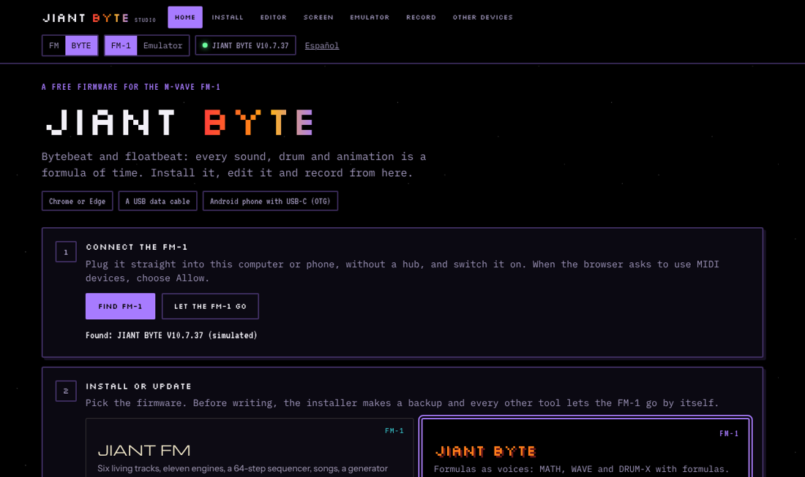

# JIANT BYTE

**▶ [Try it in the browser](https://juanjiant-bit.github.io/JIANT-BYTE/emu/)** · **[Install](https://juanjiant-bit.github.io/JIANT-BYTE/webapp/installer/)** · **[Web editor](https://juanjiant-bit.github.io/JIANT-BYTE/webapp/editor/)**

> **New: [JIANT Studio](https://juanjiant-bit.github.io/JIANT/studio/)**, everything in one page for **JIANT BYTE and
> JIANT FM**, from a computer or an Android phone. It finds the FM-1, says which firmware it runs and takes its look
> (BYTE's: stars, synthwave stripes, pixel type).
>
> - **Install** JIANT BYTE or JIANT FM. While it writes, every other tab lets the FM-1 go.
> - **Edit** the FM-1 or the emulator.
> - See the FM-1's **screen** big, full screen on a phone (needs firmware with the screen mirror, coming).
> - Play the **emulator** from a MIDI keyboard.
> - **Record** the master or the stems as WAV, and what you play as MIDI.
> - Find JIANT on **other devices**.
>
> [Try it with a simulated FM-1](https://juanjiant-bit.github.io/JIANT/studio/?mock=1&fw=byte).

**Bytebeat and floatbeat firmware for the M-VAVE FM-1.** Every sound, drum, being, punch-in and animation is a formula
of time.

> **Status: beta 1, for testing.** The work in progress is on the [`phase2-engines`](https://github.com/juanjiant-bit/JIANT-BYTE/tree/phase2-engines) branch. Try it in the browser first. On a real FM-1, back up with JIANT FM's editor before
> you install: JIANT BYTE keeps its projects apart from JIANT FM's.

JIANT BYTE is a new synthesizer on the FM-1, built on [JIANT FM](https://github.com/juanjiant-bit/JIANT) V10.7.37
(itself a fork of [Felucca](https://github.com/hugelton/Felucca) 1.1.5.1, with the song system of
[SLOOP](https://github.com/isod89/sloop-fm1)). It keeps JIANT FM's foundation (six tracks, the sequencer, songs, MIDI,
USB, the effects, the updater) and replaces the rest with formulas, from the most tonal and playable to the wildest.

## The idea

A formula reads the time `t` and returns a sample. **Bytebeat** works on whole numbers, 8 bits at a time: rhythm,
melody and grit come from bit shifts and logic (`t*(42&t>>10)`). **Floatbeat** works in fractions: sines, phases and
filters make tones, pads, bells and textures (`sin(w+sin(w*2)*a)`). JIANT BYTE gives floatbeat the most room, because
that is where the timbres are.

Everything is played through one small language, compiled on the instrument (the **FVM**: a formula machine that runs
in fixed point, a block at a time, on both of the FM-1's cores).

## Engines

| Engine | What it is |
|---|---|
| **MATH** | Formulas as voices. BYTE (48 bytebeats), FLOAT (48 floatbeats) or USER (your own text, or one the generator invents) |
| **WAVE** | A parametric wavetable of formulas: two formulas A and B, POS sweeps them, WARP bends the phase (sync, mirror, quantise, FM), three detuned voices and a sub |
| **DRUM** | DRUM-X: eight lanes, each a drum voice or a formula |
| FM-F, GLITCH, PLUCK, NOISE | Coming: one formula modulating another; granular jumps through `t`; a string excited by a formula; textures from hashes of `t` |

**CAOS** takes any formula from as written (0) to broken (127): stretches of time folded, jumped, fed back.
**TIME** decides who owns the time: **UNSYNC** (each note starts it), **SYNC** (the song's clock owns the rhythm, the
key only the pitch) or **FIJO** (the song owns all of it). **MOTION** sets the rhythm as a note value of the tempo:
1/32 to 4 bars, straight, dotted and triplets.

## The generator

With MATH on USER, **SEED** invents a formula and CAOS picks its family: in tune (0-42), the classic bytebeats (43-85)
or a random tree of operators (86-127). Each one is run and judged before it plays: silent, stuck or DC-only formulas
are thrown away. **MUTA** moves it: 1-63 mutates numbers, shifts and operators; 64-127 crosses it with a factory
formula. The same knobs always give the same formula, so the project keeps the knobs, not the text.

## LIFE: the formulas talk

HOME > LIFE has four knobs. **LIFE** is how alive it all is. **TALK** is how much each formula hears the others: their
sound goes into its time or its phase, which is FM between the tracks' formulas. **BREAK** is how much the others'
sound breaks it (its CAOS rises while they play). **WEB** sets who hears whom, from each track hearing the one before
it up to all of them hearing each other.

## Formulas everywhere

- **Macros** turned left past 0 become equations (triangle, sine, step, sample and hold, drift, bits, …) clocked to the bar.
- **Effects**: DIST's TYPE goes past its waveshapers into formula effects (ring, steps, XOR, gate, wobble, fold,
  low-pass, LFO filter, high-pass, random, saturation).
- **ARP** modes that pick the next note by an equation.
- **Punch-in** CAOS MAX (F#4 on the FX layer): every part at full CAOS while held.

## The look

A demoscene machine in JIANT's colours: pixel type, square boxes, segmented meters, JIANT FM's black, violet and
orange by default, and palettes of old computers in MENU > COLOR (BYTE, C64, AMIGA, CGA, GAMEBOY, ATARI, CONTRAST). The formula is always on the screen, with `t` running in hex. Each formula gives birth
to a **being**: a bytebeat becomes a sprite made of its own bits, mirrored; a floatbeat becomes a jellyfish drawn by
its phase portrait. Mutate the formula and the being mutates with it. On HOME the six tracks' beings stand on a horizon
drawn by the mix and jump with their sound. The power-on is a cracktro.

## Try it, install it

- **Browser**: the **[emulator](https://juanjiant-bit.github.io/JIANT-BYTE/emu/)** runs the same code as the FM-1, with
  sound, played with the computer keyboard, the mouse or a touch screen. Press **Switch on**.
- **FM-1**: open the **[web installer](https://juanjiant-bit.github.io/JIANT-BYTE/webapp/installer/)** in Chrome or Edge
  on a computer, connect the FM-1 with a USB data cable and press Install. Back up first with JIANT FM's editor.
- **Editor**: the **[web editor](https://juanjiant-bit.github.io/JIANT-BYTE/webapp/editor/)** backs up and edits the
  FM-1's projects and sounds from the computer.
- **Build it yourself**: `./build.sh` makes the package (`build/felucca.fwsc`); `web/emu/build.sh` (with Emscripten)
  the emulator.

Building and testing: [BUILDING.md](BUILDING.md). The plan and its progress, in Spanish: [JIANT-BYTE.md](https://github.com/juanjiant-bit/JIANT-BYTE/blob/phase2-engines/JIANT-BYTE.md).
JIANT FM's own documentation, the base: [docs/JIANT-FM-README.md](https://github.com/juanjiant-bit/JIANT-BYTE/blob/phase2-engines/docs/JIANT-FM-README.md).

## Credits

- **[JIANT FM](https://github.com/juanjiant-bit/JIANT)** by Juan Jiant: the base.
- **[Felucca](https://github.com/hugelton/Felucca)** by [Hügelton Instruments](https://hugelton.com) (Leo Kuroshita,
  [@kurogedelic](https://github.com/kurogedelic)) and its contributors: the base of JIANT FM, the DRUM voices and kits.
- **[SLOOP](https://github.com/isod89/sloop-fm1)** by isod89 (GPL-3.0): the song system.
- Bytebeat as a form: Ville-Matias Heikkilä (viznut) and the people who shared formulas since 2011; MATH's factory
  bytebeats come from that tradition.
- Pixel fonts: the X11 "misc-fixed" faces 5×8, 7×14 and 10×20 (public domain). Emulator: after
  [X0X](https://github.com/charlesvestal/fm1-x0x) by Charles Vestal (GPL-3.0), with
  [DotGothic16](https://github.com/fontworks-fonts/DotGothic16) ([SIL OFL 1.1](LICENSES/OFL-DotGothic16.txt)).
- Both cores: after [Melodee](https://github.com/keremimo/melodee) by keremimo and fm1-x0x by Charles Vestal.
- Package format: [JieLi AC79 SDK](https://gitee.com/Jieli-Tech/fw-AC79_AIoT_SDK) ([Apache-2.0](LICENSES/Apache-2.0.txt)).

## AI-assisted development

JIANT BYTE is developed with the help of AI agents for the code, the tests and the documentation. The instrument's
design and the decisions are made by its author.

## License

Free software: [GPL-3.0-only](LICENSE). Fonts and ported code keep their own licenses ([LICENSES/](LICENSES/));
details in [LICENSING.md](LICENSING.md).

M-VAVE and FM-1 are trademarks of their owners; JIANT BYTE is not affiliated with or endorsed by them, nor with
Hügelton Instruments.

Copyright (C) 2026 Leo Kuroshita (@kurogedelic), Hügelton Instruments — Felucca.
Copyright (C) 2026 Juan Ignacio Antonucci (Juan Jiant) — JIANT FM and JIANT BYTE.
