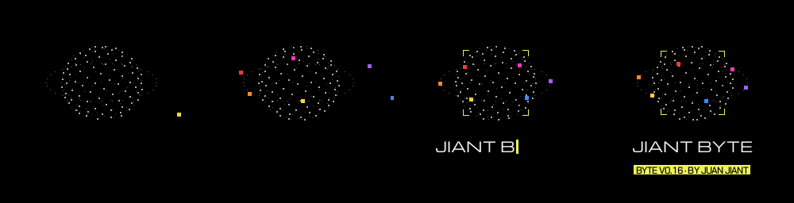
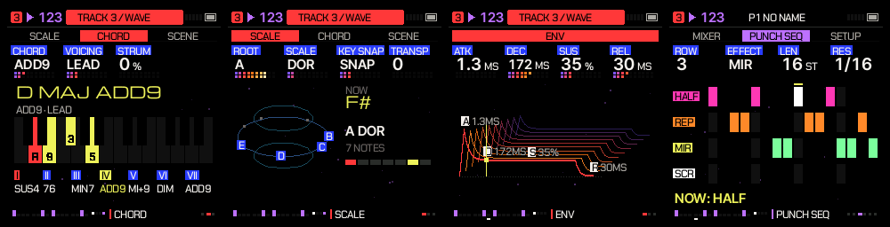

# JIANT BYTE

**▶ [Try it in the browser](https://juanjiant-bit.github.io/JIANT-BYTE/emu/)** · **[Install](https://juanjiant-bit.github.io/JIANT-BYTE/webapp/installer/)** · **[Web editor](https://juanjiant-bit.github.io/JIANT-BYTE/webapp/editor/)** · **[JIANT Studio](https://juanjiant-bit.github.io/JIANT/studio/?fw=byte)**

**Bytebeat and floatbeat firmware for the M-VAVE FM-1.** Every sound, drum, drone and punch-in is a formula of
time, played on six tracks with a full sequencer, songs and effects.

> **BETA: JIANT BYTE still needs more testing on real hardware.**
>
> - Try it in the [emulator](https://juanjiant-bit.github.io/JIANT-BYTE/emu/) first.
> - Before you install it on an FM-1, **back up your music with JIANT FM's editor**. JIANT BYTE keeps its projects
>   apart from JIANT FM's, but a backup is the only safe copy.
> - If something sounds wrong, freezes or resets, please
>   [open an issue](https://github.com/juanjiant-bit/JIANT-BYTE/issues) and say what you were doing (the page, the
>   engines, the track count). MENU > SYSTEM > ABOUT shows the version and the last crash, if any.

JIANT BYTE is a new synthesizer for the FM-1, built on [JIANT FM](https://github.com/juanjiant-bit/JIANT) V10.7.37
(itself a fork of [Felucca](https://github.com/hugelton/Felucca) 1.1.5.1, with the song system of
[SLOOP](https://github.com/isod89/sloop-fm1)). It keeps JIANT FM's foundation (six tracks, the sequencer, songs, MIDI,
USB, the effects, the updater) and replaces the sounds with formulas, from the most tonal and playable to the wildest.

## New: the emulator page

The **[emulator](https://juanjiant-bit.github.io/JIANT-BYTE/emu/)** runs the firmware itself in the browser, with
sound: the same code as the FM-1, the same screen, the same knobs. Press **Switch on** and play it with the computer
keyboard, the mouse, a touch screen or a MIDI keyboard. It is the best place to learn JIANT BYTE before installing it.

- Write and apply **FUNC** programs for MATH in a text box under the instrument.
- Render a backup's song or section as **stems** (one WAV per track, in a ZIP).
- Inside JIANT Studio, the web editor edits the emulator as if it were an FM-1, and Studio records what it plays.

## JIANT Studio

**[JIANT Studio](https://juanjiant-bit.github.io/JIANT/studio/)** is everything in one page for **JIANT BYTE and
JIANT FM**, from a computer or an Android phone. It finds the FM-1, says which firmware it runs and takes its look
(BYTE's: stars, synthwave stripes, pixel type).

- **Install** JIANT BYTE or JIANT FM. While it writes, every other tab lets the FM-1 go.
- **Edit** the FM-1 or the emulator.
- See the FM-1's **screen** big, full screen on a phone (needs firmware with the screen mirror, coming).
- Play the **emulator** from a MIDI keyboard.
- **Record** the master or the stems as WAV, and what you play as MIDI.
- Find JIANT on **other devices**.

[Try it with a simulated FM-1](https://juanjiant-bit.github.io/JIANT/studio/?mock=1&fw=byte).

## The idea

A formula reads the time `t` and returns a sample. **Bytebeat** works on whole numbers, 8 bits at a time: rhythm,
melody and grit come from bit shifts and logic (`t*(42&t>>10)`). **Floatbeat** works in fractions: sines, phases and
filters make tones, pads, bells and textures (`sin(w+sin(w*2)*A)`). JIANT BYTE gives floatbeat the most room, because
that is where the timbres are.

Everything runs on one small formula language, compiled on the instrument and run in fixed point, a block at a time,
on both of the FM-1's cores.

## Engines

Three engines, in the PRESETS list in this order (EDIT held + PRESETS jumps to the next engine):

| Engine | What it is |
|---|---|
| **DRUM-W** | The drum kit: eight pads (BD SD CP CH OH TM RS CB), each one two wavetables A and B joined by a STRUCT (MIX, FM, RING, SYNC, FOLD), with its own envelope and LFO moving the position, a body (pitch, sweep, decay) and a filtered noise. The whole kit has WAVE, MORPH, DECAY, STRIKE, ATTACK, FOLD, GAIN and CUTOFF. Twelve kits, from 909 CLUB and 808 BOOM to FLOAT KIT |
| **WAVE** | A wavetable synth where each table is a formula: two oscillators A and B, each one of sixteen formula tables (SINE, FM2, FMR, TRISY, SAWSQ, DRIVE, RING, FOLD, ODD, PULSE, STEP, BITS, FORMT, NOISE, SINTR, SATUR); POS sweeps through the frames the formula draws, WARP bends the phase (SYNC, BEND, MIRROR, QUANT, FM), MIX, DETUNE (three voices) and SUB |
| **MATH** | Formulas as voices: **BYTE** (48 bytebeats), **FLOAT** (48 floatbeats), **USER** (a formula of your own, or one the generator invents) and **FUNC** (small programs that compose a whole part) |

**CAOS** takes any MATH or WAVE formula from as written (0) to broken (127): stretches of time folded, jumped, fed
back. **TIME** decides who owns the time: each note (UNSYNC), the song's clock for the rhythm (SYNC) or the song for
everything (FIJO). Presets and the generator set them; the CAOS MAX punch-in pushes every formula to 127 while held.

**The generator for formulas.** With MATH on USER, SEED invents a formula and CAOS picks its family. Each one is run and
judged before it plays (silent, stuck or DC-only formulas are thrown away). MUTA mutates it or crosses it with a
factory formula. The same knobs always give the same formula.

**FUNC** programs are written in the same language with local variables, state and small functions, and can play a
whole piece from PLAY. FUNC is being reworked, so its controls may change in the next version.

## DRONE CLAY: a sequencer that sculpts the sound

**SEQ > DRONE CLAY** turns any track into one sound that keeps morphing. Turn **CLAY ON** and the track plays a very
low drone on its own voice (C0 to C3 on the song's root), held or struck again at a RATE, while **four modulators**
shape it in time:

- Each modulator has a **DEST** (any knob of the track's sound by its own name, CUTOFF, PITCH, PAN, the sends, LEVEL,
  LIFE …), a **SHAPE**, a **EUCLID** rhythm and an **AMOUNT** (pages CLAY MOD 1–4), plus its DECAY (CLAY DECAY).
- The shapes come in five families: **HITS** (KICK, SNARE, HAT, CLAP, ZAP, CRASH …: a hit is a bundle of moves on the
  DEST), **TABLES** (SINE, S&H, DRIFT, STAIRS, BOUNCE, CHAOS …), **GESTURES** (RAMPS, RISER, STUTTER, UP, DOWN …),
  **NOTES** (ARP UP, CHORD m, SUS4, +OCT, GLIDE DN …: real notes on the scale) and **FM** (x1/2 to x7).
- **CLAY TIME** sets the STEP (1/4 to 1/32) and the SEED. RUN **SONG** follows PLAY; **FREE** runs always.
- It lives with the other sequencers: on a MONO or LEGATO track a step's or a key's note takes the voice and the drone
  comes back after.

With CLAY ON, **the keys are gestures, not notes**:

| Keys | What they do |
|---|---|
| White keys F3 … C5 | Fire a shape into the chosen modulator (velocity is the amount). OCT picks the family: 0 HITS, +1 TABLES, +2 GESTURES, −1 NOTES, −2 FM |
| Black keys F#3 … C#4 | **MOD 1–4**: tapped, choose the modulator; held, the whites go into it |
| Black keys D#4 … A#4 | **LATCH**, **x2** (faster), **/2** (slower), **INV** (inverted), while held |
| The last seven keys (C#5 … G5) | The drone's degree on the scale |

Each key shows a **card** for a moment: the shape large, its modulator and DEST, and what it does in plain words
("DEST UP, FALLS IN HALF A STEP"). The keys play while stopped too. DRONE CLAY is saved with the project. An older
project with a FORM track loads it as WAVE with its modulators in DRONE CLAY.

## PUNCH SEQ: punch-ins on the grid

**GLO > PUNCH SEQ** sequences the punch-in effects. Four rows, each one effect (OCT−, OCT+, HALF, WOB, REP, S8, S16,
BITS, MIR, SCR, LOOP 3 / 5 / 7, CAOS MAX, LIFE MAX), sixteen steps each; rows can overlap.

- **KNOB 1** ROW, **KNOB 2** EFFECT, **KNOB 3** LEN (4–16 steps), **KNOB 4** RES (1/32 to 1/4).
- The **white keys** switch the selected row's steps on and off; **black keys 1–4** pick the row.
- It plays on all tracks, in time with the transport, exactly as if you held the key. A key held live (FX layer) keeps
  its effect on top.
- Saved in the project. CLEAR ALL and CLEAR PROJECT empty it.

## Everything else

- **Six tracks** (four by default: GLO > SYSTEM > TRACKS 6 wakes T5 and T6), each with a 64-step sequencer: piano roll
  or drum grid, parameter locks, live recording, EUCLID and MODES, PLAYHEADS, STRETCH, step components (STEP COND),
  automation (LOCKS) and TRACK GEN.
- **STRETCH** now stretches a melodic pattern in proportion: going from 4 steps to 64 keeps each note as long as its
  step (it ties them), while a drum hit stays a hit.
- **Songs**: four parts A–D per project, six projects, an ARRANGE of up to 16 rows with scenes, TIMELINE and PARTS on
  HOME, parts launched live from the SAVE layer.
- **GEN** (HOME): a whole song idea in 27 genres or EXPLORE, deterministic by seed; **MY LOOP** builds a song around
  the loop you made.
- **LIFE** (HOME): the formulas sounding at the same time trade numbers, waveform fragments and phase.
- **Punch-ins** (FX held): repeats, reverse, tape stop, freeze, the formula-time effects (OCT, HALF, WOBBLE, REPEAT,
  STEP 8/16, BITS, MIRROR, SCRAMBLE), CAOS MAX, LIFE MAX, loops, GLITCH and COMB.
- **Effects**: per-track DIST (with formula types), sends to DELAY, REVERB (ROOM, SPRING, SHIMMER, RESO, CLOUD) and
  CHORUS, a SLICER, and the master's CLIP, PUNCH, DUCK, TAPE and EQ. HOME > LIVE MIX has a DJ FILTER and three more
  live knobs.
- **Modulation**: two envelopes, an LFO, a 16-step STEP MOD, a four-slot matrix per track, four macros that can be
  equations, ARP with formula modes, CHORD and SCENE.
- **MIDI and USB**: USB and TRS MIDI, Bluetooth MIDI, USB audio with stems.

## The look

JIANT BYTE draws its screen as a flight recorder: a HUD of tags, thermal colours (cold is little, hot is a lot) and
telemetry that moves with the sound. Each track has its own colour (1 yellow, 2 orange, 3 red, 4 magenta, 5 violet,
6 blue).

- **ORBIT**, the power-on: HOME's sphere assembled point by point, the six tracks' satellites flying into their orbits,
  a yellow reticle closing and JIANT BYTE typed. It now powers on **without a click**: the output stays off until the
  audio is running, then fades in.
- **HOME** is the same orbit: each track a satellite, as large as it is loud, with a trail in its colour.
- The engines draw what they do: MATH a **census** of its formula's bytes along a Hilbert curve beside an oscilloscope,
  WAVE a **phase orbit**, DRUM-W a **radar** of its eight pads, DRONE CLAY a **telemetry** of the drone and its four
  modulators.
- The pages draw their values: **CHORD** names the chord whole and large (D MAJ ADD9, C MIN7 …) with its notes on the
  keys and the seven degrees' chords, and says why it does not sound (a DRUM track, a voice that is not POLY);
  **SCALE** turns the scale on a sphere and reads the note playing; **ENV** stacks the last notes' envelopes in
  perspective; the **LFO** is a satellite; the **DELAY** a tunnel of echoes; the **REVERB** a thermal matrix; FOCUS
  one knob large with its modulation.

JIANT FM's palette is the default; MENU > DISPLAY > COLOR has C64, CONTRAST, AMIGA, CGA, GAMEBOY, ATARI and BYTE.

## What's new in this beta

- **DRONE CLAY**: FORM is no longer an engine. Its composer is now a sequencer on any track (see above), with the
  keys as gestures and a card for each key.
- **PUNCH SEQ** (GLO): four rows of punch-ins on the transport.
- **DRUM-W** replaces DRUM-X: eight pads on wavetables.
- **WAVE** draws each formula once into a real wavetable and reads it back: the same sound for much less CPU.
- **CHORD** and **SCALE** pages with graphs and chord naming; new HUD pictures for HOME, ENV, LFO, SENDS, FX, MIXER,
  FOCUS and the song.
- **STRETCH** in proportion for melodic patterns.
- **ORBIT** power-on, and no click at power-on.
- **Lighter CPU** across the engines, the master chain and DRONE CLAY. **ABOUT** (MENU > SYSTEM) shows how long each
  engine takes per audio block.
- **Removed**: the FORM engine (now DRONE CLAY), SEQ > MUTATE, GLO > COMP (the global step components), the FX layer's
  recorded punch-in lane (PUNCH SEQ replaces it), FILTER 2 (the filter's noise modulator), FX > BALANCE and the unused
  engines left over from JIANT FM. Projects that used them still load.

Earlier notes: [v0.14](docs/byte-v014.md) · [v0.8](docs/byte-v08.md) · [v0.7](docs/byte-v07.md) ·
[v0.5](docs/byte-v05.md) · [v0.4](docs/byte-v04.md).

## Try it, install it

- **Browser**: the **[emulator](https://juanjiant-bit.github.io/JIANT-BYTE/emu/)**. Press **Switch on**.
- **FM-1**: open the **[web installer](https://juanjiant-bit.github.io/JIANT-BYTE/webapp/installer/)** (or JIANT
  Studio) in Chrome or Edge on a computer, connect the FM-1 directly with a USB data cable and press Install. Back up
  first with JIANT FM's editor.
- **Editor**: the **[web editor](https://juanjiant-bit.github.io/JIANT-BYTE/webapp/editor/)** backs up and edits the
  FM-1's projects and sounds from the computer.
- **Manual** (Spanish): [docs/MANUAL-BYTE.es.md](docs/MANUAL-BYTE.es.md).

## Building

`./build.sh` makes the package (`build/felucca.fwsc`); `web/emu/build.sh` (with Emscripten) the emulator. Details and
tests: [BUILDING.md](BUILDING.md). The README's screenshots come from the firmware's own screens:
`python3 tools/gen_byte_readme_images.py`. JIANT FM's own documentation, the base:
[docs/JIANT-FM-README.md](docs/JIANT-FM-README.md).

## Credits

- **[JIANT FM](https://github.com/juanjiant-bit/JIANT)** by Juan Jiant: the base.
- **[Felucca](https://github.com/hugelton/Felucca)** by [Hügelton Instruments](https://hugelton.com) (Leo Kuroshita,
  [@kurogedelic](https://github.com/kurogedelic)) and its contributors: the base of JIANT FM, the DRUM voices and kits.
- **[SLOOP](https://github.com/isod89/sloop-fm1)** by isod89 (GPL-3.0): the song system.
- Bytebeat as a form: Ville-Matias Heikkilä (viznut) and the people who shared formulas since 2011; MATH's factory
  bytebeats come from that tradition.
- Pixel fonts: the X11 "misc-fixed" faces 5×8, 7×14 and 10×20 (public domain). Emulator: after
  [X0X](https://github.com/charlesvestal/fm1-x0x) by Charles Vestal (GPL-3.0), with
  [DotGothic16](https://github.com/fontworks-fonts/DotGothic16) ([SIL OFL 1.1](LICENSES/OFL-DotGothic16.txt)).
- Both cores: after [Melodee](https://github.com/keremimo/melodee) by keremimo and fm1-x0x by Charles Vestal.
- Package format: [JieLi AC79 SDK](https://gitee.com/Jieli-Tech/fw-AC79_AIoT_SDK) ([Apache-2.0](LICENSES/Apache-2.0.txt)).

## AI-assisted development

JIANT BYTE is developed with the help of AI agents for the code, the tests and the documentation. The instrument's
design and the decisions are made by its author.

## License

Free software: [GPL-3.0-only](LICENSE). Fonts and ported code keep their own licenses ([LICENSES/](LICENSES/));
details in [LICENSING.md](LICENSING.md).

M-VAVE and FM-1 are trademarks of their owners; JIANT BYTE is not affiliated with or endorsed by them, nor with
Hügelton Instruments.

Copyright (C) 2026 Leo Kuroshita (@kurogedelic), Hügelton Instruments — Felucca.
Copyright (C) 2026 Juan Ignacio Antonucci (Juan Jiant) — JIANT FM and JIANT BYTE.
