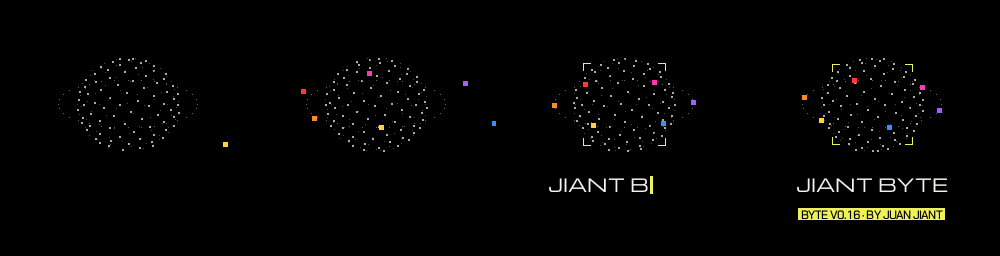
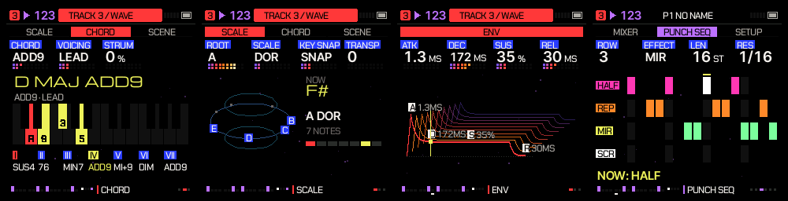

# JIANT BYTE — Manual de usuario

**Beta (v0.16, rama byte-cpu-light)** · firmware bytebeat y floatbeat para el M-VAVE FM-1

Este manual es para quien acaba de instalar JIANT BYTE (o lo abrió en el emulador) y quiere saber cómo tocarlo, cómo
armar temas y cómo guardar su trabajo sin perder nada. Los controles aparecen nombrados como los muestra el equipo, en
mayúsculas: **SELECT**, **OCT+**, **DRONE CLAY**.

JIANT BYTE está construido sobre JIANT FM (V10.7.37, a su vez un fork de Felucca 1.1.5.1 con el sistema de canciones de
SLOOP). De JIANT FM conserva la base: seis pistas, el secuenciador, las canciones, los efectos, MIDI, USB y el
actualizador. Todo lo demás lo reemplaza por fórmulas: cada sonido, golpe, drone y punch-in es una fórmula del tiempo.
Si venís de JIANT FM, el panel, la navegación, el secuenciador y el guardado te van a resultar conocidos; los motores
son otros (no hay ANALOG, PHASE, FM6, VOICE, WHEEL, ANIMAL ni EXT).

> **Estado: beta. JIANT BYTE todavía necesita más pruebas en equipos reales.**
>
> - Probalo primero en el [emulador](https://juanjiant-bit.github.io/JIANT-BYTE/emu/).
> - En un FM-1 real, **hacé un backup con el editor de JIANT FM antes de instalar**. JIANT BYTE guarda sus proyectos
>   aparte de los de JIANT FM, pero el backup es la única copia segura.
> - Si algo suena mal, se cuelga o se reinicia, contalo en
>   [un issue](https://github.com/juanjiant-bit/JIANT-BYTE/issues): qué estabas haciendo, en qué página, con qué
>   motores y cuántas pistas. MENU › SYSTEM › ABOUT muestra la versión y el último crash.

Si vas a leer un solo capítulo, leé [Guardar y cargar](#14-guardar-y-cargar). Si querés que suene ya, andá a
[Inicio rápido](#0-inicio-rápido).

## Contenido

- [Qué hay de nuevo en esta beta](#qué-hay-de-nuevo-en-esta-beta)
0. [Inicio rápido](#0-inicio-rápido)
1. [El panel](#1-el-panel)
2. [La pantalla](#2-la-pantalla)
3. [Páginas y capas](#3-páginas-y-capas)
4. [Motores](#4-motores): [MATH](#41-math), [WAVE](#42-wave), [DRUM-W](#43-drum-w), [las páginas comunes](#44-las-páginas-comunes)
5. [LIFE](#5-life)
6. [El generador](#6-el-generador)
7. [El secuenciador](#7-el-secuenciador) (con [DRONE CLAY](#drone-clay-el-sonido-que-se-modela))
8. [ARRANGE: temas, partes y escenas](#8-arrange-temas-partes-y-escenas)
9. [Dados y UNDO](#9-dados-y-undo)
10. [Efectos y master](#10-efectos-y-master)
11. [Modulación y macros](#11-modulación-y-macros)
12. [Tocar en vivo](#12-tocar-en-vivo) (con [PUNCH SEQ](#punch-seq-los-punch-in-en-la-grilla))
13. [Sistema: TRACKS, LOAD y el MENU](#13-sistema-tracks-load-y-el-menu)
14. [Guardar y cargar](#14-guardar-y-cargar)
15. [MIDI y USB](#15-midi-y-usb)
16. [Herramientas web](#16-herramientas-web)
17. [CPU y rendimiento](#17-cpu-y-rendimiento)
18. [Problemas y preguntas frecuentes](#18-problemas-y-preguntas-frecuentes)

---

## Qué hay de nuevo en esta beta

**FORM ya no es un motor: ahora es DRONE CLAY**, un secuenciador que puede tener cualquier pista. Prendés **CLAY** en
**SEQ › DRONE CLAY** y la pista toca un drone muy grave con su propia voz, mientras cuatro moduladores (golpes, tablas,
gestos, notas y FM, cada uno con su ritmo euclídeo) lo van modelando a través de cualquier perilla de su sonido. Con
CLAY prendido las teclas son gestos y cada una muestra una tarjeta que dice qué hace. Ver
[DRONE CLAY](#drone-clay-el-sonido-que-se-modela).

**PUNCH SEQ** (GLO): cuatro filas de punch-in de 16 pasos que tocan solas con el transporte, sobre todas las pistas.
Ver [PUNCH SEQ](#punch-seq-los-punch-in-en-la-grilla).

**DRUM-W** reemplaza a DRUM-X: ocho pads hechos de wavetables. Ver [DRUM-W](#43-drum-w).

**La pantalla nueva.** El arranque **ORBIT** (la esfera de HOME que se arma punto por punto, los satélites de las seis
pistas entrando en órbita, JIANT BYTE escrito), HOME como órbita, y cada página dibujando lo que hace: **CHORD** nombra el
acorde entero, **SCALE** gira la escala en una esfera, **ENV** apila las envolventes, el **DELAY** es un túnel, DRUM-W un
radar, MATH un censo de su fórmula. Ver [La pantalla](#2-la-pantalla).

**Más cosas:**

- **WAVE** dibuja cada fórmula una vez en una tabla de verdad y la lee: el mismo sonido con mucha menos CPU.
- **STRETCH** estira una secuencia melódica en proporción: pasar de 4 a 64 pasos mantiene cada nota tan larga como su
  paso. Un golpe de batería sigue siendo un golpe.
- **CHORD** con los nombres de JIANT FM, y te dice por qué un acorde no suena (una pista DRUM, una voz que no es POLY).
- **Sin click al encender**: la salida espera a que el audio ande y después sube de a poco.
- **CPU más liviana** en los motores, en la cadena del master y en DRONE CLAY. **MENU › SYSTEM › ABOUT** muestra cuánto
  tarda cada motor por bloque de audio.
- **Se fueron**: el motor FORM (ahora DRONE CLAY), **SEQ › MUTATE**, **GLO › COMP** (los componentes globales), el
  carril grabado de punch-in de la capa FX (ahora está PUNCH SEQ), **FILTER 2** (el modulador de ruido del filtro),
  **FX › BALANCE** y los motores de JIANT FM que quedaban sin usar. Los proyectos que los usaban cargan igual: una
  pista FORM vieja carga como WAVE con sus moduladores en DRONE CLAY.

---

## 0. Inicio rápido

### Probarlo sin instalar nada

Abrí el **emulador** en el navegador: <https://juanjiant-bit.github.io/JIANT-BYTE/emu/>. Es el mismo código que corre en
el FM-1, con sonido. Apretá **Switch on**. Se toca con el mouse, con una pantalla táctil o con el teclado de la
computadora (ver [Herramientas web](#16-herramientas-web)).

### Instalarlo en el FM-1

1. **Hacé un backup** con el editor de JIANT FM si tenés música en el equipo.
2. Abrí el **instalador web** en Chrome o Edge en una computadora:
   <https://juanjiant-bit.github.io/JIANT-BYTE/webapp/installer/>
3. Conectá el FM-1 **directo** con un cable USB de datos (sin hub).
4. Apretá **Install** y no desenchufes el cable mientras escribe.

Si tu FM-1 tiene otro firmware custom (Felucca, Skiff, baudgirl…), volvé primero al oficial: ver
[Problemas y preguntas](#18-problemas-y-preguntas-frecuentes).

### Tu primer sonido (1 minuto)

1. Encendé el equipo. Aparece el arranque **ORBIT** (la esfera, los satélites, **JIANT BYTE**) y después llegás a
   **HOME**, a la página **MACROS**: la órbita de las pistas.
2. Un proyecto nuevo arranca así: **T1 WAVE** (INIT WAVE), **T2 DRUM-W** (ACOUSTIC), **T3 WAVE** (SUB BASS), **T4 MATH**
   (MATH KEYS), **T5 WAVE** (SAW PAD) y **T6 MATH** (BYTEBEAT). Con **TRACKS 4**, el valor de fábrica, suenan T1–T4. Las
   secuencias arrancan vacías.
3. Tocá las teclas: suena la pista elegida. Para oír algo que se mueve solo, probá [DRONE CLAY](#drone-clay-el-sonido-que-se-modela)
   en T1: **SEQ**, SELECT hasta **DRONE CLAY**, KNOB 1 en **ON** y **PLAY**.
4. Girá **ALGORITHM** hasta **T3** o **T4** y tocá las teclas.
5. Girá **PRESETS**: se abre la lista de sonidos. Seguí girando para elegir y apretá **OCT+** para cargar. **EDIT
   mantenido + PRESETS** salta al primer sonido del motor siguiente.
6. Apretá **EDIT** y girá **KNOB 1–4**: son los parámetros del motor de la pista.
7. ¿No te gusta? Mantené **EDIT** y girá **SELECT**: el sonido se tira a los dados. **OCT+** lo deja, **OCT−** lo
   devuelve.

### Tu primer tema (5 minutos)

1. Mantené **HOME** y girá **SELECT**: se abre el **generador** (GEN 1). Elegí un género con **KNOB 1**, o dejalo en
   **EXPLORE**, y apretá **OCT+**. Sale una idea de tema completa: motores, sonidos, partes, escala, tempo y efectos.
   Apretá **PLAY**.
2. ¿No te convence? **OCT+** otra vez: semilla nueva, pieza nueva. Si querés volver a lo de antes: mantené **GLO** y
   apretá **G4** (UNDO).
3. ¿Te gusta? **Pará** (PLAY), apretá **SAVE** y girá **SELECT** hasta **PART SLOTS**. Girá **KNOB 4** a la derecha
   hasta que su tarjeta diga **OCT+**, apretá **OCT+**, escribí un nombre (o dejá el que te ofrece) y apretá **OCT+**
   otra vez. La pantalla dice **SAVED**.
4. Hacé una variación (cambiá pasos, muteá una pista) y guardala en la parte **B**: en PART SLOTS, **KNOB 1** hasta
   **B**, después KNOB 4 y OCT+ como antes.
5. Andá a **HOME › ARRANGE** (tocá HOME hasta llegar). **OCT+** agrega una fila; **KNOB 2** su parte y **KNOB 3** sus
   compases. Agregá una fila para A y otra para B y apretá **PLAY**.

Ese es todo el ciclo: **hacer música → guardarla en una parte → encadenar partes en ARRANGE**.

---

## 1. El panel

### Encoders y perillas

| Control | Qué hace |
| --- | --- |
| **SELECT** | Recorre las páginas de la sección, una por paso, en una sola cadena; frena en la primera y en la última. En el MENU recorre sus filas. Con un botón mantenido: **HOME** abre GEN, **EDIT / SEQ / LFO / FX** tiran los dados de esa parte, **GLO** cambia el tempo, **ENV / SCL / ARP / SAVE** recorren la cadena de esa sección. |
| **ALGORITHM** | Elige la pista desde cualquier página: T1–T6 (T1–T4 con TRACKS 4). En el MENU, la pestaña siguiente. Con una capa mantenida, su vista: MAP, KNOBS, STATE. |
| **PRESETS** | Siempre sonidos, con una lista: el primer giro la abre sobre cualquier página (no carga nada), PRESETS la recorre, **OCT+** carga, **OCT−** o unos segundos sin tocar la cierran. Con un botón mantenido: **EDIT** salta al primer sonido del motor siguiente o anterior, **SEQ** mueve el paso, **HOME** el tempo. Nunca cambia de página ni de pista. |
| **KNOB 1–4** | Las cuatro tarjetas de la pantalla. Si una página elige algo (un paso, un slot, un sonido del kit, una fila), lo elige **KNOB 1**. Rápido recorre todo el rango, despacio ajusta fino (MENU › CONTROL › KNOB ACCEL lo apaga). |
| **MASTER** | El volumen de salida. |

### Botones

| Botón | Toque | Mantener |
| --- | --- | --- |
| **HOME** | La sección HOME. Adentro, el grupo siguiente, en ronda: **LIFE → MACROS → LIVE MIX → TRACKS → TIMELINE → ARRANGE → PARTS → GEN**. Al encender abre en MACROS. | Unos 0,7 s: el **MENU**. Mantenido + SELECT: **GEN**. |
| **EDIT** | La sección EDIT (el sonido de la pista). Adentro, el grupo siguiente. | Capa **EDIT**: INIT, RECALL, mutes de los sonidos del kit. Mantenido + SELECT: los **dados de sonido**. Mantenido + KNOB 1–4: un cambio momentáneo que vuelve al soltar. |
| **SEQ** | La sección SEQ. Adentro, el grupo siguiente. | Capa **SEQ TOOLS**; **G5** CLR STEP. Mantenido + SELECT: los **dados de secuencia**. |
| **FX** | La sección FX. Adentro, el módulo siguiente. | Capa de **FX punch-in** (ver [Tocar en vivo](#12-tocar-en-vivo)). Mantenido + SELECT: los dados de efectos. |
| **LFO** | La sección LFO: LFO → STEP MOD → MATRIX. | Capa **MACRO**: KNOB 1–4 son M1–M4. Mantenido + SELECT: los dados del LFO. |
| **ENV** | La sección ENV (ENV · ENV DEST · ENV 2). | — |
| **SCL** | La sección SCL: SCALE → CHORD → SCENE. | Capa **SCL**: las teclas fijan la tónica. |
| **ARP** | La sección ARP (ARP · ARP 2). | — |
| **GLO** | La sección GLO: MIXER → PUNCH SEQ → SETUP. | Capa **GLO**: mutes, solos, tap tempo, **UNDO** (G4). Mantenido + SELECT: el tempo. |
| **SAVE** | La sección SAVE: TOOLS → PROJECTS → PART SLOTS → USER → PRESETS. | Capa **SAVE**: tocar y guardar partes en vivo; **C5** NAME. |
| **PLAY** | Arranca y para. | ~0,7 s: **PANIC**, corta todo el sonido. |
| **REC** | Arma o desarma la grabación en la pista elegida. | Capa **REC**. Mantenido solo y soltado sin tocar nada más: **UNDO**. |
| **OCT− / OCT+** | La octava del teclado (−3 a +3; los dos juntos vuelven a 0). En páginas de acción y diálogos: **OCT−** = atrás / NO, **OCT+** = hacerlo / YES. | — |

### Las teclas

27 teclas de **F3 a G5** (16 blancas, 11 negras). Tocan la pista elegida. Con una capa mantenida son atajos de esa
capa; en la grilla de batería son pasos y carriles; en la pantalla NAME escriben.

Las teclas F3..C5 leen la **velocidad** (qué tan fuerte tocás) y el **aftertouch** (apretar más una tecla ya abajo, la
fuente **AT** de la matriz). La fila de arriba (C#5..G5) no tiene sensor y toca con el promedio de tus golpes
recientes. La curva se elige en MENU › CONTROL › VELOCITY; cada tecla aprende tu toque mientras tocás (VEL LEARN).

### Combinaciones útiles

| Combinación | Resultado |
| --- | --- |
| **GLO** + **PLAY** | Reinicia desde el principio sin parar. |
| **PLAY** mantenido | **PANIC**: para el transporte y corta todas las notas, también las colgadas de MIDI. |
| **GLO** + **SELECT** | El tempo, desde cualquier página. |
| **GLO** + **G4** | **UNDO** del último cambio grande (otra vez: rehacer). |
| **SEQ** + **REC** | **CLEAR ALL SEQUENCES?**: los pasos y la automatización de todas las pistas. |
| **REC** + **FX / EDIT / ENV / LFO / SCL / ARP / GLO** | Borra la automatización de esa parte en la pista elegida. |
| **SAVE** + **OCT+** / **OCT−** | Guarda la música en la parte que está sonando / la recupera como quedó guardada. |
| **HOME** + **SELECT** | **GEN**, el generador de temas. |
| **EDIT / SEQ / LFO / FX** + **SELECT** | Los dados: sonido, secuencia, LFO, efectos. |
| **EDIT** + **PRESETS** | El primer sonido del motor siguiente o anterior. |
| **SEQ** + **G5** | **CLR STEP**: borra el paso del cursor y sus locks. |
| **SAVE** + **C5** | **NAME**: renombra el slot, la parte o el proyecto. |
| Un paso mantenido + **KNOB 1–4** | Un parameter lock en ese paso. |
| Una nota mantenida + **OCT−** / **OCT+** | Teclas de expresión: OCT− hace entrar un vibrato, OCT+ dobla la nota hacia arriba (MENU › AUDIO › OCT BEND); al soltar vuelven solas. |
| **OCT− + OCT+** al encender | HARDWARE CALIBRATION. |
| **OCT− + OCT+** 5 s con el equipo andando | Modo de actualización, con cuenta regresiva; soltá para cancelar. |

---

## 2. La pantalla

### El aspecto

La pantalla de JIANT BYTE es como un registrador de vuelo: rótulos en etiquetas, colores térmicos y telemetría que se
mueve con el sonido. Los colores funcionan como una cámara térmica: frío (azul, violeta) es poco, caliente (rojo,
naranja, amarillo, blanco) es mucho. Lo que está sonando o lo que acabás de tocar se pone **amarillo**.

**Cada pista tiene su color**: 1 amarillo, 2 naranja, 3 rojo, 4 magenta, 5 violeta, 6 azul. En las páginas de una
pista, arriba aparece una barra de su color con **TRACK N / MOTOR**.

**MENU › DISPLAY › COLOR** cambia la paleta: **JIANT** (la de fábrica) y C64, CONTRAST, AMIGA, CGA, GAMEBOY, ATARI y
BYTE.



**El arranque, ORBIT**: la esfera de HOME se arma punto por punto, los satélites de las seis pistas entran en su
órbita, se cierra una mira amarilla y se escribe **JIANT BYTE**, con la versión en una etiqueta amarilla. El equipo
arranca sin click: la salida queda apagada hasta que el audio ya corre y después sube de a poco.

### Las partes de la pantalla

- **Encabezado** (arriba): la pista elegida en su color, el estado del transporte, los **BPM**, el punto de REC; al medio
  qué es la página (la pista y su motor, o el proyecto en las páginas del tema); a la derecha el **medidor de carga**
  (barritas) y la batería. Los mensajes aparecen al medio ("SAVED", "DRONE CLAY ON"…).
- **Pestañas**: los **grupos** de la sección; el actual encendido.
- **Tarjetas**: las cuatro son KNOB 1–4: el nombre en una etiqueta arriba, el valor debajo y una fila de celdas que se
  encienden en colores térmicos. La perilla que acabás de girar toma el color de la pista. Una tarjeta vacía quiere
  decir "acá ahora no hay nada". Una acción armada (SAVE, LOAD, ERASE…) dice **OCT+**: apretá OCT+ para hacerla.
- **Panel** (al medio): el dibujo de la página (ver abajo).
- **Pie**: la sección y la página en una etiqueta, y a la derecha el lugar de la página en la cadena, por ejemplo
  **DRONE CLAY 13/19**.

### Lo que dibuja cada página

| Página | Qué se ve |
| --- | --- |
| **HOME** | La **órbita**: una esfera de alambre que gira y cada pista un satélite en su órbita, tan grande como suena, con una estela de su color; su etiqueta (número y motor) en una columna. LIFE dibuja las conexiones entre ellas |
| **MATH** | El **censo** de la fórmula: sus bytes a lo largo de una curva de Hilbert, cada uno con su calor, y un osciloscopio al lado |
| **WAVE** | La **órbita de fase**: el ciclo de la fórmula en POS dibujado contra sí mismo, y la mezcla de A y B |
| **DRUM-W** | Un **radar**: cada pad un sector con su tabla dibujada en redondo; un golpe enciende su sector |
| **DRONE CLAY** | **Telemetría**: OUT (el drone) y los cuatro moduladores como trazos de lo que suman ahora, con su SHAPE y su DEST |
| **CHORD** | El acorde con su **nombre entero** y grande (D MAJ ADD9, C MIN7…), sus notas en dos octavas de teclas con sus intervalos y los siete grados con la calidad de su acorde |
| **SCALE** | La escala en una **esfera** que gira, la tónica en el color de la pista, la nota que suena en amarillo; al lado la nota, la escala y sus grados |
| **ENV** | Las **capas**: las envolventes de las últimas notas apiladas en perspectiva, cada una tan alta como su velocidad, con los valores de A D S R |
| **LFO** | Un **satélite** en su órbita según la fase, escribiendo la onda |
| **FOCUS** | Un parámetro grande, con su barra térmica y cuánto lo mueve la matriz |
| **DELAY** | Un **túnel**: cada eco un cuadro en perspectiva hacia el centro |
| **REVERB** | La cola como una matriz térmica |
| **MIXER, SENDS** | Columnas de celdas térmicas por pista |
| **PUNCH SEQ** | Las cuatro filas con sus pasos, el cabezal y **NOW:** con lo que está sonando |



### Diálogos y mensajes

Antes de cualquier cosa destructiva aparece una pregunta: **OCT− NO**, **OCT+ YES**. Los dados muestran **BEFORE** y
**NOW** lado a lado y debajo **SELECT: DICE AGAIN · OCT− CANCEL · OCT+ OK**.

Los mensajes aparecen como una píldora chica cerca del pie del panel, sin tapar la página. Con **MENU › DISPLAY › HELP**
el encabezado dice qué hace la perilla mientras la girás.

---

## 3. Páginas y capas

### Cómo funciona la navegación: seis reglas

Todas las secciones se manejan igual: lo aprendés una vez y ya las conocés todas.

1. **SELECT recorre las páginas.** Pasa por todas las páginas de la sección en una sola cadena, una por paso, y frena en
   la primera y en la última.
2. **El botón de la sección entra o salta.** Desde otra sección te devuelve a la última página donde estabas ahí. Si ya
   estás adentro, salta a la **primera página del grupo siguiente** (y da la vuelta).
3. **PRESETS carga sonidos.** Siempre, en todas las secciones, con su lista. Nunca cambia de página ni de pista.
4. **KNOB 1 elige.** Si una página elige algo, lo elige KNOB 1. La pista es siempre de **ALGORITHM**.
5. **Mantener abre la capa.** Mantener un botón abre su capa de atajos (más allá del tiempo HOLD, MENU › CONTROL › HOLD,
   0,4 s de fábrica). Un mapa muestra qué hace cada tecla; soltá y volvés.
6. **La pantalla dice dónde estás.** Las pestañas son los grupos; el pie dice **SECCIÓN · GRUPO · página** y **n/N**.

Cada sección recuerda la página donde la dejaste. Algunas páginas solo aparecen cuando corresponden (las de DRUM-W en una
pista de batería, SLICER y CHORUS no con LOAD ECO); la cadena las saltea.

### Las secciones y sus cadenas

| Sección | Grupos (el botón) · páginas (SELECT) |
| --- | --- |
| **HOME** | **LIFE**: LIFE — **MACROS**: MACROS — **LIVE MIX**: LIVE MIX — **TRACKS**: TRACKS — **TIMELINE**: TIMELINE — **ARRANGE**: ARRANGE — **PARTS**: PARTS — **GEN**: GEN 1 · GEN 2 · GEN 3 |
| **EDIT** (MATH, WAVE) | **SOUND**: FORMULA · MOTION (MATH) o WAVE · OSC B (WAVE) — **TONE**: FILTER · TONE — **FOCUS**: FOCUS — **PLAY**: PLAY · MORE |
| **EDIT** (DRUM-W) | **PLAY**: PLAY — **PAD**: WAVE · SHAPE · MOVE · BODY · NOISE — **KIT**: COLOR · MIX |
| **SEQ** | **STEP**: STEP — **PATTERN**: LENGTH · RHYTHM · TRACK — **EUCLID**: EUCLID · MODES — **PLAYHEADS**: PLAYHEADS — **STRETCH**: STRETCH — **STEP COND**: STEP COND · COND 2 — **LOCKS**: LOCKS — **TRACK GEN**: TRACK GEN — **CLAY**: DRONE CLAY · CLAY MOD 1–4 · CLAY DECAY · CLAY TIME |
| **FX** | **TRACK**: SENDS · DIST · AUTO PAN — **BUSES**: BUSES — **DELAY**: DELAY · DELAY 2 · DELAY 3 — **REVERB**: REVERB · REVERB 2 — **CHORUS**: CHORUS — **SLICER**: SLICER · SLICER IN · SLICER IN2 · SL PITCH — **MASTER**: MASTER · TAPE · EQ |
| **GLO** | **MIXER**: MIXER · BUS SENDS — **PUNCH SEQ**: PUNCH SEQ — **SETUP**: GLOBAL · SYSTEM · PORTS |
| **ENV** | **ENV**: ENV · ENV DEST · ENV 2 |
| **LFO** | **LFO**: LFO · LFO 2 · LFO DEST — **STEP MOD**: STEP MOD · STEP MOD 2 — **MATRIX**: MATRIX |
| **SCL** | **SCALE**: SCL — **CHORD**: CHORD — **SCENE**: SCENE |
| **ARP** | **ARP**: ARP · ARP 2 |
| **SAVE** | **TOOLS**: TOOLS — **PROJECTS**: PROJECTS — **PART SLOTS**: PART SLOTS — **USER**: USER — **PRESETS**: PRESETS |

Las dos primeras páginas de EDIT llevan el nombre que les da el motor: **FORMULA / MOTION** en MATH y **WAVE / OSC B** en
WAVE.

### Las páginas de HOME

- **LIFE**: el intercambio de timbre entre fórmulas. Ver [LIFE](#5-life).
- **MACROS**: **KNOB 1–4** son las macros **M1–M4** del proyecto. La órbita de las pistas gira en el panel; al girar una macro,
  arriba se ve adónde va ("NO ROUTE" si no va a ningún lado: armala en LFO › MATRIX).
- **LIVE MIX**: el osciloscopio de la mezcla y cuatro modificadores globales para tocar en vivo: **FILTER** (el DJ
  FILTER: a la izquierda un pasabajos, a la derecha un pasaaltos, al medio apagado), **SPACE** (el delay y la reverb de
  toda la mezcla juntos), **DRIVE** (el CLIP del master) y **DUCK** (cuánto bombea la mezcla con el bombo). Con **EDIT**
  mantenido son momentáneos.
- **TRACKS**: cada pista como un carril con su patrón; **KNOB 1** la pista, **KNOB 2** LEVEL, **KNOB 3** PAN, **KNOB 4**
  REV. Mute: **GLO + tecla negra** (F#3 = T1…); solo: **GLO + tecla blanca** sostenida (F3 = T1…).
- **TIMELINE, ARRANGE, PARTS**: las páginas del tema. Ver [ARRANGE](#8-arrange-temas-partes-y-escenas).
- **GEN 1–3**: el generador. Ver [El generador](#6-el-generador).

### Cada página y sus cuatro perillas

"—" es una tarjeta vacía. Las páginas de los motores están en [Motores](#4-motores).

**ENV** (por pista)

| Página | KNOB 1 | KNOB 2 | KNOB 3 | KNOB 4 |
| --- | --- | --- | --- | --- |
| ENV | ATK | DEC | SUS | REL |
| ENV DEST | FILTER | PITCH | SHAPE | LOOP |
| ENV 2 | ATK | DEC | SUS | REL |

**LFO** (por pista)

| Página | KNOB 1 | KNOB 2 | KNOB 3 | KNOB 4 |
| --- | --- | --- | --- | --- |
| LFO | RATE | WAVE | MODE (TRIG / FREE) | FADE |
| LFO 2 | PHASE | — | — | — |
| LFO DEST | PITCH | FILTER | SHAPE | AMP |
| STEP MOD | STEP (1–16) | LEVEL | LEN | SLEW |
| STEP MOD 2 | DIV | — | — | — |
| MATRIX | SLOT (1–4) | SRC | DEST | AMT |

**EDIT**: las páginas de los motores y las comunes están en [Motores](#4-motores).

**FX**

| Página | KNOB 1 | KNOB 2 | KNOB 3 | KNOB 4 |
| --- | --- | --- | --- | --- |
| SENDS | DIST | CHORUS | DLY | REV |
| DIST | TYPE | TONE | NOISE | DIST |
| AUTO PAN | DEPTH | RATE | SYNC | WAVE |
| BUSES | DLY (MIX del delay) | REV (SIZE de la reverb) | CHO (DEPTH del chorus) | SLC (DEPTH del SLICER) |
| DELAY | TIME | FEEDBK | TONE | MIX |
| DELAY 2 | WIDE | PITCH | SPRAY | MOD |
| DELAY 3 | TYPE | PING | DRIVE | R TIME |
| REVERB | TYPE | SIZE | DAMP | PRE |
| REVERB 2 | MOD | RATE | FILT | WIDE |
| CHORUS | RATE | DEPTH | STEREO | — |
| SLICER | MODE | PAT | RATE | DEPTH |
| SLICER IN | T1 | T2 | T3 | T4 |
| SLICER IN2 | T5 | T6 | FX | — |
| SL PITCH | STEP | PITCH | LEN | QUANT |
| MASTER | CLIP | PUNCH | DUCK | REL |
| TAPE | TAPE | WOW | — | — |
| EQ | LOW | LO MID | HI MID | HIGH |

**SCL**

| Página | KNOB 1 | KNOB 2 | KNOB 3 | KNOB 4 |
| --- | --- | --- | --- | --- |
| SCL | ROOT | SCALE | KEY SNAP | TRANSP |
| CHORD | CHORD | VOICING | STRUM | — |
| SCENE | SCENE (OFF / ON) | TRACK | ROLE | CHORD |

**GLO**

| Página | KNOB 1 | KNOB 2 | KNOB 3 | KNOB 4 |
| --- | --- | --- | --- | --- |
| MIXER | LEVEL | PAN | MUTE | G.SWING |
| BUS SENDS | CHORUS | DLY | REV | — |
| PUNCH SEQ | ROW | EFFECT | LEN | RES |
| GLOBAL | BPM | G.SWING | CLOCK | TUNE |
| SYSTEM | TRACKS | LOAD | ROUTE | CPU |

**ARP** (por pista)

| Página | KNOB 1 | KNOB 2 | KNOB 3 | KNOB 4 |
| --- | --- | --- | --- | --- |
| ARP | MODE | RATE | OCT | GATE |
| ARP 2 | ARP SWG | PROB | HOLD | ORDER |

Además de los modos de siempre (UP, DN, UPDN, RND, ORD, REPEAT…), **MODE** tiene ocho modos de fórmula, **E:3X, E:XOR,
E:SQR, E:GRAY, E:TAB, E:GROW, E:JUMP, E:HASH**: la nota siguiente sale de una ecuación del paso (un bytebeat de los
pasos), así el arpegio dibuja un patrón que casi nunca se repite igual.

**SAVE** y **HOME › TIMELINE / ARRANGE / PARTS**: ver [Guardar y cargar](#14-guardar-y-cargar) y
[ARRANGE](#8-arrange-temas-partes-y-escenas).

### Las capas (mantené el botón)

Mientras mantenés un botón, las teclas y las perillas cambian de función y un mapa muestra qué hace cada tecla. Girá
**ALGORITHM** con el botón mantenido para pasar entre **MAP · KNOBS · STATE**. Las capas:

- **EDIT**: **F3** INIT (el sonido de fábrica del motor), **G3** RECALL (el sonido como está guardado en la parte), teclas
  negras 1–8 mutean los pads del kit en una pista DRUM-W. KNOB 1–4 mantenidas: el cambio vuelve al soltar.
- **GLO**: teclas negras 1–6 mutean T1–T6, blancas F3.. hacen solo mientras las mantenés, teclas negras 7–10 mutean los
  grupos del kit (KICK, SNARE, HAT, PERC), **F4** TAP tempo, **G4** UNDO.
- **SCL**: las teclas fijan la tónica.
- **SEQ** (SEQ TOOLS): herramientas de la secuencia; **G5** CLR STEP.
- **REC**: CLEAR, CLICK, REC Q.
- **SAVE**: tocar y guardar partes en vivo (ver [ARRANGE](#tocar-partes-en-vivo-capa-save)); **C5** NAME.
- **LFO** (MACRO): KNOB 1–4 son M1–M4; **F3** tira rutas de macro nuevas, **G3** las borra.
- **FX**: los punch-in (ver [Tocar en vivo](#12-tocar-en-vivo)).

---

## 4. Motores

JIANT BYTE tiene tres motores. En la lista de PRESETS van en este orden, en una lista continua: **DRUM-W → WAVE →
MATH**, y de vuelta a DRUM-W. **EDIT mantenido + PRESETS** salta al primer sonido del motor siguiente o anterior.

| Motor | Qué es |
| --- | --- |
| **DRUM-W** | La batería: ocho pads, cada uno dos wavetables A y B unidas por una estructura, con su envolvente, su LFO, su cuerpo y su ruido. |
| **WAVE** | Un wavetable donde cada tabla es una fórmula: dos osciladores A y B, POS los recorre, WARP dobla la fase, tres voces desafinadas y un sub. |
| **MATH** | Fórmulas como voces: BYTE (48 bytebeats), FLOAT (48 floatbeats), USER (una fórmula propia o inventada por el generador) y FUNC (programas que componen). |

Una fórmula lee el tiempo `t` y devuelve una muestra. **Bytebeat** trabaja con enteros, 8 bits a la vez: ritmo, melodía
y suciedad salen de desplazamientos de bits y lógica (`t*(42&t>>10)`). **Floatbeat** trabaja con fracciones: senos,
fases y filtros hacen tonos, pads, campanas y texturas (`sin(w+sin(w*2)*A)`). Todo corre en una pequeña máquina de
fórmulas que se compila en el instrumento y trabaja en punto fijo, en los dos núcleos del FM-1.

¿Y FORM? Ya no es un motor: su compositor es ahora **DRONE CLAY**, un secuenciador que cualquier pista puede prender
(ver [DRONE CLAY](#drone-clay-el-sonido-que-se-modela)). Un proyecto o un preset de usuario viejo con una pista FORM la
carga como WAVE, con sus moduladores en DRONE CLAY.

Las páginas que comparten MATH y WAVE (FILTER, TONE, FOCUS, PLAY, MORE) se explican al final del capítulo, en
[Las páginas comunes](#44-las-páginas-comunes).

### 4.1 MATH

MATH toca fórmulas como voces. **WAVE** (KNOB 2 de FORMULA) elige el tipo: **BYTE**, **FLOAT**, **USER** o **FUNC**.
Las páginas cambian según el tipo.

**BYTE y FLOAT**

| Página | KNOB 1 | KNOB 2 | KNOB 3 | KNOB 4 |
| --- | --- | --- | --- | --- |
| FORMULA | CHIP | WAVE | ALGO | VAR |
| MOTION | MOTION | GRIT (BYTE) / FEEDBK (FLOAT) | BEND | LOOP |

- **CHIP**: la resolución. BYTE: **4BIT, 4B/2** (4 bits sostenidos dos muestras), **8BIT, 1BIT**. FLOAT: **4BIT, 4B/2,
  FULL** (suave, el de fábrica), **1BIT**.
- **ALGO**: la fórmula. BYTE: **B01–B48**; FLOAT: **F01–F48**.
- **VAR**: la variable de la fórmula (las que la leen cambian con ella).
- **MOTION**: el tiempo lento de la fórmula (su ritmo, su frase) como valor de nota del tempo: **LIBRE** (a su propio
  paso), después **1/32** hasta **4** compases, rectos, con puntillo (.) y tresillos (T).
- **GRIT** (BYTE): las muestras sostenidas más tiempo, un reductor de frecuencia. **FEEDBK** (FLOAT): la salida vuelve al
  tiempo de la fórmula, de un brillo a un caos.
- **BEND**: dobla el tiempo de la fórmula.
- **LOOP**: encierra el tiempo en una ventana corta que se repite con la nota: la evolución larga de la fórmula queda
  como un tono afinado.
- **RTRG** (en **MORE**): **ON** (de fábrica) arranca la fórmula desde el principio en cada nota, para que la voz toque
  afinada.

Los presets de MATH, en el orden de la lista: para tocar, **MATH KEYS, MATH BASS, MATH PAD, MATH LEAD, MATH BELL, FLOAT
PAD**; experimentos, **BYTEBEAT, BYTE VAR, BYTE BENT, BYTE TONE, FLOAT ARP**; y **INIT FLOAT, FUNC SONG, FUNC BEAT**.

**USER: una fórmula inventada**

| Página | KNOB 1 | KNOB 2 | KNOB 3 | KNOB 4 |
| --- | --- | --- | --- | --- |
| FORMULA | CHIP (hasta FULL) | WAVE | SEED (0–191) | MUTA (0–127) |
| MOTION | MOTION | GRIT / FEEDBK | BEND | LOOP |

Con WAVE en **USER**, **SEED** inventa una fórmula. Cada una se corre y se juzga antes de sonar: las que quedan mudas,
trabadas o solo con continua se descartan. **MUTA** la mueve: **1–63** muta números, desplazamientos y operadores;
**64–127** la cruza con una fórmula de fábrica. Las mismas perillas dan siempre la misma fórmula, así que el proyecto
guarda las perillas, no el texto. SEED y MUTA son destinos de la matriz: un LFO sobre SEED recorre fórmulas (cambian de a
saltos, con un fundido corto, nunca dentro del audio).

Si la parte tiene un texto propio guardado, SEED y MUTA lo mutan en lugar de inventar uno.

**CAOS y TIME**

Cada parte de MATH y WAVE tiene además dos valores: **CAOS** lleva cualquier fórmula de como está escrita (0) a rota
(127): tramos del tiempo plegados, saltados, realimentados. **TIME** decide de quién es el tiempo: **UNSYNC** (cada nota lo
arranca), **SYNC** (el reloj de la canción es dueño del ritmo, la tecla solo de la altura) o **FIJO** (la canción es dueña
de todo). Estos dos valores no tienen una página en el panel: los fijan los presets y el generador, y en vivo el
punch-in **CAOS MAX** pone todas las fórmulas en CAOS 127 mientras lo mantenés.

#### FUNC: programas que componen

FUNC es un programa propio, con variables locales, estado por voz y funciones chicas, corrido por la misma máquina de
fórmulas del instrumento. No es JavaScript. Para empezar, elegí el preset **FUNC SONG** o **FUNC BEAT** y apretá
**PLAY**: una función produce la pieza completa. Con **RUN** la función sigue al transporte (una voz por pista, la pieza
entera) o arranca en cada nota (para instrumentos y texturas); cuatro perillas **A–D** son controles del programa y
destinos de la matriz.

| Página | KNOB 1 | KNOB 2 | KNOB 3 | KNOB 4 |
| --- | --- | --- | --- | --- |
| EDIT 1 | RUN (NOTE / SONG) | WAVE | A | B |
| EDIT 2 | C | D | ROOT (−24…+24) | FORM (CUSTOM, SONG, BEAT y las recetas) |

- **RUN SONG** sigue a PLAY / STOP con una voz por pista: el teclado no duplica la pieza (usá ROOT para transponerla).
  **RUN NOTE** corre la función desde cada nota, para instrumentos y texturas.
- **FORM** explora las dos composiciones (SONG, BEAT) y vuelve a tu código (**CUSTOM**). Cambiar FORM o de preset no
  borra el texto CUSTOM.
- **A–D** son controles del programa (0–100 %) y destinos de la matriz. Cada FORM les pone nombre (en las tarjetas, la
  matriz y el editor) y, con MENU > DISPLAY > HELP, una línea arriba que dice qué hace la perilla mientras la girás. En
  CUSTOM se llaman A B C D. Todo lo que cambia un ritmo va por pasos de la grilla (nunca se desfasa de la secuencia):

  | FORM | A | B | C | D |
  | --- | --- | --- | --- | --- |
  | SONG | COLOR (voicing y color) | SNARE (cada 2 tiempos o cada 1) | HATS (2, 4 u 8 por tiempo) | STEPS (1, 2 o 4 notas por tiempo) |
  | BEAT | COLOR (armónicos del bajo) | SNARE (cada 2 o cada 1) | HATS (2, 4 u 8) | KICK (3-3-2, en negras o cada 2) |
  | GROWL | VOWEL | WOBBLE (2, 4, 6 u 8 por compás) | DRIVE | SEED |
  | HALFTIME | DEPTH | RING | DRIVE | SEED |
  | ACID | CUTOFF | RESO | DRIVE | SEED |
  | REESE | DETUNE | TONE | DRIVE | SEED |
  | HOUSE | CHORD | BASS | KICK | SEED |
  | STRUM | COLOR | CHORD (menor, mayor, sus4) | DRIVE | SEED |
  | JUST | BRIGHT | FM | DRIVE | SEED |
  | PLUCK | SHAPE | TONE | DRIVE | SEED |
  | NIBBLE | PWM | SUB | DRIVE | SEED |
  | BITS | SLOW | KICK | DRIVE | SEED |
  | DRUMS | HATS | SNARE | KICK | SEED |
  | SCREECH | INDEX | RATIO | FOLD | CRUSH (y semilla) |

  **SEED** elige qué notas de la tabla y qué ritmo (eu()) toca la receta: cada valor, otra pieza.
- La página del motor muestra, debajo del código, el compás que suena: los 16 pasos con el actual marcado, una fila por
  cada tambor del programa (KICK, SNARE, HAT) y por cada ritmo eu() (ACT), la nota (NOTE, o TONE: el armónico que eligió
  la tabla) y las cuatro perillas con su nombre.
- **OCT+** en la página del motor abre el editor del programa; **OCT+** aplica, **OCT−** cancela. Un programa con error
  muestra el error y conserva el anterior. Editar una plantilla y aplicarla la convierte en CUSTOM. El emulador tiene
  además un editor de texto debajo del instrumento.

Lo que tiene un programa:

| Expresión | Qué da |
| --- | --- |
| `note(midi, edad, color)` | una nota con envolvente de un tiempo; color agrega armónicos |
| `chord(raíz, edad, color)` | cuatro notas, envolvente de cuatro tiempos |
| `kick(edad)`, `snare(edad)`, `hat(edad)` | bombo, caja, hat |
| `P` | tiempos (beats): el transporte, o desde la nota |
| `t`, `T` | muestras y segundos desde que arrancó la voz |
| `w` | la fase de la nota, en vueltas |
| `n`, `v`, `freq`, `sr` | nota MIDI, velocidad, frecuencia, frecuencia de muestreo |
| `A B C D` | los controles, 0..1 |

`let` crea una variable local, `state` una que sigue entre muestras (vuelve a cero en una nota nueva), `fn` una función
de un argumento. `sin()` trabaja en vueltas. Por ejemplo:

```c
func{fn partial(z)=sin(w*z)*.1;return partial(1)+partial(3)+partial(5)+partial(7)+partial(9);}
```

Límites: 255 caracteres, 64 instrucciones, seis locales, dos palabras de estado, dos funciones propias, ocho
componentes de helpers a la vez (un `chord` cuenta cuatro). Sin bucles libres ni recursión.

**Guardá el proyecto** para conservar el programa: los presets de usuario no guardan programas FUNC (te lo avisa).

### 4.2 WAVE

WAVE es un wavetable como los sintes de wavetable por software, pero cada tabla la dibuja una ecuación. **POS** recorre
los "cuadros" que dibuja la fórmula. WAVE dibuja cada fórmula una vez en una tabla de 128 puntos (y la vuelve a dibujar de
a poco cuando movés POS), y todas las voces de la pista la leen: suena igual que la fórmula escrita y cuesta mucho menos.
BITS, STEP y NOISE, CAOS y una pista de una sola voz siguen calculando la fórmula exacta.

| Página | KNOB 1 | KNOB 2 | KNOB 3 | KNOB 4 |
| --- | --- | --- | --- | --- |
| WAVE | A | POS | WARP | AMT |
| OSC B | B | MIX | DETUNE | SUB |

- **A** y **B**: la tabla de cada oscilador, una de dieciséis fórmulas:

  | Nombre | Qué hace POS |
  | --- | --- |
  | **SINE** | un seno puro |
  | **FM2** | un modulador 2:1, POS su índice |
  | **FMR** | la relación y el índice suben con POS |
  | **TRISY** | un triángulo sincronizado hacia arriba |
  | **SAWSQ** | de sierra a cuadrada |
  | **DRIVE** | un seno saturado |
  | **RING** | anillado con un parcial |
  | **FOLD** | plegado |
  | **ODD** | crecen los parciales impares |
  | **PULSE** | POS el ancho del pulso |
  | **STEP** | un seno escalonado, menos escalones hacia abajo |
  | **BITS** | el byte de la fase XOR el de POS |
  | **FORMT** | un seno sincronizado en una ventana |
  | **NOISE** | un ciclo de ruido, más fino hacia arriba |
  | **SINTR** | de seno a un triángulo una octava arriba |
  | **SATUR** | dos parciales en fase, saturados |

- **POS**: la posición (la variable A de la fórmula). Es también el destino **SHP** de la matriz.
- **WARP**: cómo se dobla la fase antes de la fórmula: **OFF, SYNC, BEND, MIRROR, QUANT, FM** (B dentro de la fase de A).
  **AMT** es su cantidad.
- **MIX**: de A a B.
- **DETUNE**: en 0 una voz; subiendo, tres voces abiertas alrededor de la nota.
- **SUB**: un seno una octava abajo.

Presets de WAVE: **INIT WAVE, FM KEYS, SAW PAD, SYNC LEAD, SUB BASS, BIT TABLE, FM BELL, FORMANT**.

### 4.3 DRUM-W

DRUM-W es la batería de BYTE: ocho pads, **BD SD CP CH OH TM RS CB** (bombo, caja, palmas, hat cerrado, hat abierto,
tom, rim, cencerro). Cada pad son dos **wavetables** (las mismas dieciséis fórmulas de WAVE), **A** y **B**, unidas por una
estructura, con una envolvente y un LFO que mueven la posición, un cuerpo (afinación y barrido) y un ruido filtrado.

**Los kits**: DRUM-W (el de fábrica), 909 CLUB, 808 BOOM, LOFI DUST, INDUSTRIAL, ACOUSTIC, DUB ROOTS, TECHNO RAW,
BREAKS, HIP HOP, LATIN PERC y FLOAT KIT. Cargar uno carga el kit completo en la parte. Hay **un kit por parte**,
compartido por todas las pistas DRUM-W: si otra pista toca DRUM-W, recorrer kits en una pista distinta lo deja como está
("KIT OF T4 KEPT").

Las páginas van en tres grupos: **PLAY** (todo el kit), **PAD** (un pad: KNOB 1 lo elige) y **KIT**.

| Página | KNOB 1 | KNOB 2 | KNOB 3 | KNOB 4 |
| --- | --- | --- | --- | --- |
| PLAY | WAVE | MORPH | DECAY | STRIKE |
| WAVE | PAD | TABLE A | POS | TABLE B |
| SHAPE | PAD | STRUCT | AMOUNT | RATIO |
| MOVE | PAD | ENV | DECAY | LFO |
| BODY | PAD (con su lado A / B) | PITCH | SWEEP | DECAY |
| NOISE | PAD | NOISE | CUTOFF | TYPE |
| COLOR | ATTACK | FOLD | GAIN | CUTOFF |
| MIX | PAD | LEVEL | STEREO | METAL |

- **PLAY**: perillas para todo el kit mientras toca. **MORPH** lleva cada pad de su lado A a su lado B.
- **WAVE**: las dos tablas del pad y dónde está su posición (**POS**).
- **SHAPE**: cómo se unen A y B: **STRUCT** **MIX, FM, RING, SYNC** o **FOLD**; **AMOUNT** cuánto; **RATIO** la relación de
  B (1/2 a 8).
- **MOVE**: la envolvente que mueve la posición al golpe (**ENV**, su **DECAY**) y un **LFO**.
- **BODY**: la afinación, el barrido (**SWEEP**) y el decay del lado que estás editando.
- **NOISE**: el ruido, su corte y su **TYPE** (blanco, rosa, marrón, violeta o resonante, con filtro HP, BP o LP).
- **COLOR**: el kit entero: **ATTACK** (la subida de un ADSR), **FOLD**, **GAIN** (de limpio a +12 dB) y **CUTOFF**.
- **MIX**: el nivel del pad, el estéreo del kit y **METAL**, un pasabanda sobre los metales.

La página PLAY dibuja el kit como un radar: cada pad un sector con su tabla, y el que suena se enciende.

**Mutes**: GLO mantenido + teclas negras 7–10 mutean los grupos KICK, SNARE, HAT, PERC; EDIT mantenido + teclas negras
1–8 mutean cada pad. **EDIT + SELECT** tira los dados del kit. **EDIT + F3** (INIT) trae de vuelta el kit de fábrica.

Los punch-in blancos de las fórmulas (HALF, WOBBLE, REPEAT, STEP, BITS, MIRROR, SCRAMBLE) también actúan en DRUM-W:
cambian cómo se recorren los pasos y al soltar vuelven a tiempo.

El kit se guarda con cada parte del proyecto, no con los presets de usuario.

### 4.4 Las páginas comunes

Valen para MATH y WAVE. Los grupos de EDIT son **SOUND** (las páginas del motor), **TONE** (FILTER, TONE), **FOCUS** y
**PLAY** (PLAY, MORE).

| Página | KNOB 1 | KNOB 2 | KNOB 3 | KNOB 4 |
| --- | --- | --- | --- | --- |
| FILTER | TYPE | CUT | RES | IMAGE |
| TONE | KEY TRK | CRUSH | LIFE | — |
| FOCUS | el parámetro (E1–E8) | su valor | SRC (el slot de la matriz que apunta a él) | AMT |
| PLAY | POLY | GLIDE | UNISON | VEL |
| MORE (MATH) | RTRG | GL MODE | UNISON | VEL |
| MORE (WAVE) | VOICES | — | — | — |

**FILTER**: **TYPE** LP, HP, BP, **COMB**, **COMB-** (filtros peine afinados a la nota: CUT los mueve, RES es cuánto
resuenan; COMB metálico, COMB- hueco, de armónicos impares) o **LP24** (un pasabajos de 24 dB/oct); **CUT**; **RES**;
**IMAGE** (las voces repartidas en el estéreo).

**TONE**: **KEY TRK** (el corte sigue a la nota, 0–100 %), **CRUSH** (el reductor de bits de la pista) y **LIFE** (el
LIFE de esta pista, ver [LIFE](#5-life)).

**FOCUS**: un parámetro del motor en grande, con su barra térmica y cuánto lo mueve la matriz; abajo los ocho con sus
barras. **KNOB 1** lo elige, **KNOB 2** lo ajusta, **KNOB 3** la fuente del slot de la matriz que apunta a él (subirla
desde OFF toma un slot libre), **KNOB 4** el AMT.

**PLAY**: **POLY** (POLY, MONO, LEG, UNI, DRONE), **GLIDE**, **UNISON** (cuánto se abren las voces de UNI) y **VEL**
(cuánta velocidad le llega al sonido: 0 % toca todo parejo). **DRONE** deja sonar la nota al soltarla; la siguiente se
desliza hasta ahí. Para apagarlo, tocá otra vez sola la tecla de una nota que suena, o MUTE.

**MORE**: en MATH **RTRG** y **GL MODE** (RATE o TIME: cómo se mide el glide); en WAVE **VOICES** (cuántas voces puede
usar la pista, 1–8: menos voces, menos CPU).

---

## 5. LIFE

LIFE hace que las fórmulas que suenan a la vez se intercambien timbre. No es un efecto encima de la mezcla: una voz toma
números, formas de onda y fase de las otras voces que están sonando, y se transforma. Las fórmulas originales, los
presets y los proyectos no se reescriben nunca.

### HOME › LIFE

Es la primera página de HOME (tocá HOME desde MACROS hasta dar la vuelta, o SELECT a la izquierda).

| Perilla | Control | Qué hace |
| --- | --- | --- |
| **KNOB 1** | **LIFE** | La profundidad, 0–100. **0 es apagado, bit por bit** (y no gasta CPU). La curva es progresiva: el recorrido bajo y medio es amplio para ajustar fino, el extremo queda al final. |
| **KNOB 2** | **NUM** | Intercambia **números** de las fórmulas (y su VAR o su A) como coeficientes del segundo y tercer armónico, afinados a la nota que recibe. Nunca toca divisores, máscaras ni relojes. |
| **KNOB 3** | **FRAG** | Intercambia **fragmentos**: formas de onda de banda limitada (hasta ocho armónicos, sin continua) de las otras voces, reconstruidas en la fase de la nota que recibe. |
| **KNOB 4** | **LINK** | Deforma esa forma con la fase, los números y las envolventes de las otras voces: cuánto se enredan. |

De fábrica: **LIFE 0, NUM 65, FRAG 60, LINK 40**. NUM, FRAG y LINK no hacen nada hasta que subís LIFE. Cuánto vale LIFE
por dentro:

| LIFE | Profundidad |
| --- | --- |
| 0 | apagado |
| 25 | ~4 % |
| 50 | ~19 % |
| 75 | ~49 % |
| 100 | 100 % |

La pantalla muestra la órbita de las pistas que suenan y una línea entre cada par que se está intercambiando, más gruesa
cuanto más.

### Quién participa

- **Todos los motores, en las dos direcciones**: MATH (BYTE y FLOAT), WAVE y DRUM-W. No hay un motor central ni
  parejas fijas.
- **Hacen falta notas superpuestas**: una voz sola no tiene con quién intercambiar. También se conectan dos notas de la
  misma pista (un acorde).
- Los golpes de DRUM-W cambian a las otras voces en sus primeros ~100 ms.
- Mute, solo y las voces que terminaron dejan de participar. La profundidad no depende del volumen de la pista donante:
  el LEVEL y las envolventes deciden qué notas participan, no cuánto.

### El LIFE de cada pista

**EDIT › TONE, KNOB 3** es el LIFE propio de la pista, 0–100 % (100 de fábrica), por
el de HOME. En 0 la pista queda afuera: ni recibe ni da. En la matriz, **LIFE** es una fuente (la respiración de la
pista), **BEING** otra (su pulso en la página LIFE) y **LIFE** un destino (el LIFE de la pista, sumado).

### Para escucharlo

1. Hacé sonar dos sonidos distintos a la vez (un pad de WAVE sostenido mientras toca un bytebeat de MATH, por ejemplo).
2. HOME › LIFE: **LIFE 50, NUM 65, FRAG 60, LINK 40**. Después subí LIFE a 75–100.
3. Para oír solo el intercambio de formas: FRAG 100, NUM y LINK en 0, y recorré LIFE.
4. Muteá la pista donante para escuchar qué aportaba.

### Lo que conviene saber

- **El generador arranca siempre con LIFE en 0**, en todas sus formas (LOOP, PARTS, SONG, MY LOOP).
- LIFE se guarda con el proyecto (los cuatro valores y el de cada pista).
- **LIFE MAX** (FX mantenido + **A#4**) pone LIFE al 100 % mientras lo mantenés, sin guardarlo.
- Con mucha carga, la protección le saca LIFE a todas las pistas menos a la elegida (con un deslizamiento) y se lo
  devuelve unos 2 s después de que se calma. Ver [CPU y rendimiento](#17-cpu-y-rendimiento).

---

## 6. El generador

Hay dos generadores: **GEN**, que arma un tema entero, y **TRACK GEN**, que escribe solo la pista elegida.

### GEN: un tema entero (HOME › GEN)

Mantené **HOME** y girá **SELECT** desde cualquier página, o tocá **HOME** hasta llegar a **GEN** (el último grupo de
HOME). Son tres páginas: **SELECT** pasa de una a otra, **KNOB 1–4** fijan los valores, **OCT+** arma la pieza y
**OCT−** vuelve a MACROS (la pieza queda). **PLAY** arranca y para sin salir.

| Página | KNOB 1 | KNOB 2 | KNOB 3 | KNOB 4 |
| --- | --- | --- | --- | --- |
| **GEN 1** | **GENRE** | **SEED** 0000–9999 | **ENERGY** 0–100 % | **FORM**: LOOP, PARTS, SONG, MY LOOP |
| **GEN 2** | **DRUMS** | **BASS** | **CHORDS** | **ARP** |
| **GEN 3** | **LEAD** | **COMPLEX** 0–100 % | **SWING** AUTO o 0–100 % | **HUMAN** 0–100 % |

- **GENRE**: **EXPLORE** (ningún género, todas las reglas rotas; así arranca al encender), **RANDOM** (a veces un mutante
  de dos géneros) o uno de: MINIMAL TECHNO, HARD TECHNO, HARD BASS, HOUSE, DEEP HOUSE, TECH HOUSE, TRIBAL, CUMBIA,
  REGGAETON, DEMBOW, ELECTRO, BREAKBEAT, DRUM & BASS, IDM GLITCH, IDM AMBIENT, IDM WEIRD, KRAUT, EBM, NEO CLASSIC, FUGA,
  ELECTRO METAL, TECHNO ROCK, DREAM POP, PHONK, BAILE FUNK, JAZZ, HIP HOP. El género queda elegido entre visitas.
- **DRUMS, BASS, CHORDS, ARP, LEAD**: cada parte **OFF**, 10–100 % o **AUTO** (lo que pide el género). OFF queda apagada.
- **ENERGY** empuja tempo, densidad y calor; **COMPLEX** la complejidad; **SWING** y **HUMAN** el groove.
- **FORM**: **LOOP** (un loop), **PARTS** (partes A B A C en ARRANGE), **SONG** (un tema con plan: intro, build, drop,
  break, outro) o **MY LOOP** (ver abajo).

**Es determinista.** Los mismos ajustes dan siempre la misma pieza. **OCT+ sin tocar nada tira una semilla nueva**;
girá una perilla y apretá OCT+ y tenés la misma pieza con esa sola cosa cambiada: cada parte saca sus números de su
propio flujo, así que mover BASS deja la batería y el lead como estaban. La pantalla dice **LAST: HOUSE 0421** (el
género y la semilla).

**Cómo suena en BYTE.** El género pone la armonía, el ritmo, las envolventes y el arreglo. Los sonidos se eligen por rol
musical entre presets propios de MATH y WAVE, con DRUM-W para la batería:

- **Bajo**: familias floatbeat de fundamental y parciales enteros, o WAVE con sub; sin CAOS ni BEND al azar.
- **Pads y lead**: floatbeats armónicos y FM, o WAVE con POS, mezcla y ancho controlados.
- **Arpegios y texturas**: bytebeats rítmicos con VAR propio y evolución a tempo; las texturas pueden usar CAOS
  controlado.
- **Batería**: FLOAT KIT adaptado al género.

En PARTS y SONG las partes B, C y D desarrollan el timbre con automatización (POS en WAVE, BEND en BYTE, el filtro en
FLOAT). GEN deja **LIFE en 0** y DRONE CLAY apagado.

**Una base limpia.** Cada pieza arranca del estado de CLEAR PROJECT: nada de lo anterior se cuela. Se conservan el tempo
con BPM LOCK, el nombre del proyecto y tus propias partes. **UNDO** (GLO + G4) devuelve la música de antes.

**GEN no genera mientras suena un tema**: dice **SONG PLAYS: STOP IT TO EDIT**. Pará el tema, o apagá el modo SONG con
SAVE + D5.

### MY LOOP: tu loop hecho tema

Con **FORM: MY LOOP**, **OCT+** toma el loop que está sonando y arma un tema alrededor:

- Primero guarda tu loop **tal cual como A** (pistas vacías, sonidos, fórmulas del kit, notas, velocidades, gates, swing,
  automatización).
- Construye las partes nuevas y las variaciones en **B, C y D**, en la tonalidad y el tempo de tu loop.
- **PLAY** toca el arreglo completo en modo SONG. A queda intacta.
- La misma entrada y la misma semilla dan el mismo arreglo. Si una parte no entra en la memoria, lo avisa y conserva tu
  loop.

### TRACK GEN: una sola pista (SEQ › TRACK GEN)

La última página de SEQ escribe el patrón de la pista elegida con las reglas del generador, sin tocar las otras.

| KNOB 1 | KNOB 2 | KNOB 3 | KNOB 4 |
| --- | --- | --- | --- |
| **GENRE** | **SEED** | **ROLE** (BASS, CHORDS, LEAD, ARP) o, en una pista DRUM-W, **COMPLEX** | **ENERGY** |

**OCT+** escribe la pista. Respeta la tonalidad de la canción y el bombo de la pista de batería. No funciona con un tema
sonando (**STOP SONG TO EDIT**).

---

## 7. El secuenciador

Cada pista tiene su propio patrón de **64 pasos** con su largo (LEN), división (DIV), swing y gate, así que patrones de
distinto largo giran unos contra otros. Además de los pasos, cada pista puede tener [DRONE CLAY](#drone-clay-el-sonido-que-se-modela),
un drone que se modela solo.

### La cadena de SEQ

| Grupo | Páginas | Para qué |
| --- | --- | --- |
| **STEP** | STEP | Escribir pasos: el piano roll (melódica) o la grilla (batería). |
| **PATTERN** | LENGTH · RHYTHM · TRACK | El largo, la división, el swing y el gate; SPAN y FIT; la altura, CHANCE, HUMAN y REC Q de la pista. |
| **EUCLID** | EUCLID · MODES | Patrones euclídeos y sus modos. |
| **PLAYHEADS** | PLAYHEADS | Tres cabezales más sobre el mismo patrón. |
| **STRETCH** | STRETCH | Estirar, repetir, empujar y rotar el patrón. |
| **STEP COND** | STEP COND · COND 2 | Hasta dos componentes por paso. |
| **LOCKS** | LOCKS | La automatización y los locks, como lista. |
| **TRACK GEN** | TRACK GEN | El generador de la pista. |
| **CLAY** | DRONE CLAY · CLAY MOD 1–4 · CLAY DECAY · CLAY TIME | El drone que se modela (ver [DRONE CLAY](#drone-clay-el-sonido-que-se-modela)). |

Todas las páginas muestran el mismo piano roll del compás, con las filas de la escala teñidas, el cursor y el cabezal;
cada página dibuja lo suyo encima. **SEQ mantenido + PRESETS** mueve el paso; PRESETS solo carga sonidos.

| Página | KNOB 1 | KNOB 2 | KNOB 3 | KNOB 4 |
| --- | --- | --- | --- | --- |
| STEP (melódica) | STEP (los 64) | NOTE | TIME | VEL |
| STEP (batería) | STEP | LANE | HIT | ACC |
| LENGTH | LEN | DIV | SWING | GATE |
| RHYTHM | SPAN | FIT | — | — |
| TRACK | PITCH | CHANCE | HUMAN | REC Q |
| EUCLID | HITS (batería: DENSITY) | STEPS | ROTATE | VARY (batería: LANE) |
| MODES | VOICES | HARM (batería: GHOST) | OCTAVE (batería: RATCHET) | SLIDE (batería: VARY) |
| PLAYHEADS | HEAD | RATE | DIR | INTERVAL |
| STRETCH | STRETCH | REPEAT | NUDGE | ROTATE |
| STEP COND | ACTION | LENGTH | CONDITION | VALUE |
| COND 2 | ACTION | LENGTH | CONDITION | VALUE |
| LOCKS | ROW | STEP | PARAM | VALUE |
| TRACK GEN | GENRE | SEED | ROLE / COMPLEX | ENERGY |
| DRONE CLAY | CLAY (OFF / ON) | DRONE (C0–C3 en la tónica) | RATE | RUN (SONG / FREE) |
| CLAY MOD 1–4 | DEST | SHAPE | EUCLID | AMOUNT |
| CLAY DECAY | DECAY 1 | DECAY 2 | DECAY 3 | DECAY 4 |
| CLAY TIME | STEP | SEED | — | — |

### Escribir pasos

- **SEQ › STEP** en una pista melódica es un **piano roll**: KNOB 1 el paso, KNOB 2 la nota, KNOB 3 **TIME**, KNOB 4
  **VEL**. Un paso guarda hasta cuatro notas.
- **TIME** es un solo recorrido: REST ← TIE ← NOTE → 2 ST → … → 16 ST. A la derecha alarga la nota (los pasos siguientes
  se vuelven TIEs), a la izquierda la acorta hasta volverla TIE y después REST (REST borra el paso). La nota siguiente
  frena el alargue (**NEXT NOTE**).
- **VEL**: 1–127 la velocidad del paso; pasado 127, **ACC** (acento), **SLD** (slide) y **A+S**.
- **Grabación por pasos**: en STEP, con el transporte **parado**, apretá **REC** (**KEYS WRITE STEPS**). Tocá una nota o un
  acorde: entra en el paso del cursor y al soltar el cursor avanza. Con las teclas apretadas, **KNOB 1** (o SELECT) fija
  cuántos pasos dura. Con las teclas apretadas, **ARP** escribe el acorde arpegiado (KNOB 1 la resolución, KNOB 2 el
  orden, KNOB 3 las octavas).
- **SEQ + G5** (CLR STEP) borra el paso del cursor y sus locks.
- En una pista **DRUM-W**, STEP es una **grilla**: las teclas blancas son los 16 pasos de la página, las negras 1–8 eligen
  el carril (y lo tocan), la negra 9 mantenida es ACC, las negras 10 y 11 cambian de página cuando LEN pasa de 16. **KNOB 3
  HIT** recorre --, ON, x2, x4, x8, SHORT, GHOST, FLAM.

### Grabación en vivo

Apretá **REC** (no en STEP con el transporte parado): la pista queda armada y arranca el transporte. Lo que tocás se
graba en overdub, cuantizado a los pasos. Los movimientos de perilla en la pista elegida se graban como
**automatización**. Se graba la duración de cada nota, el legato (como SLIDE en una pista LEG o UNI) y la velocidad.
**REC Q** (TRACK, KNOB 4; 100 % de fábrica) cuantiza dónde empiezan las notas: en 0 % conserva tu timing. MENU › AUDIO
tiene **CLICK**, **CLICK LEVEL** y **COUNT-IN**.

### Parameter locks y LOCKS

Mantené un paso (en STEP) y girá una perilla: ese valor queda **lockeado** en ese paso. **SEQ › LOCKS** muestra arriba
una fila con **PLAY** (la automatización ON / OFF), cuántos LOCK y REC hay y **OCT+** CLEAR ALL; debajo los registros como
lista (LOCK, REC o RAMP, su paso, su parámetro y su valor), que se editan con las cuatro perillas.

### EUCLID y MODES

**EUCLID** reparte **HITS** golpes en **STEPS** pasos, **ROTATE** los corre; en batería **LANE** elige el carril (ALL: todo
el kit, la primera perilla es la densidad), en melódica **VARY** cambia las notas. **MODES** son cuatro modos con su
cantidad (en melódica voces, armonía, octava, slide; en batería voces, fantasmas, ratchets, variación).

### STRETCH

**STRETCH** estira el patrón, **REPEAT** lo repite, **NUDGE** lo empuja y **ROTATE** lo rota. En una pista melódica el
estiramiento es proporcional: cada nota se alarga en la misma medida (sus pasos quedan ligados), así que pasar de 4 a
64 pasos mantiene cada nota tan larga como su paso. En una pista de batería un golpe sigue siendo un golpe.

### Componentes de paso (STEP COND · COND 2)

Hasta dos por paso, cada uno con **ACTION** (qué hace: arpegio, ratchet, salto, sonido…), **LENGTH** (1–32 pasos que
cubre), **CONDITION** (en qué pasadas del patrón actúa) y **VALUE**. En el roll, un paso con componentes lleva una marca
arriba.

### Copiar y pegar

En el roll o la grilla, mantené las teclas de los pasos y girá **SELECT**: se copian. Una tecla de paso + **REC** los pega
desde ese paso.

### DRONE CLAY: el sonido que se modela

DRONE CLAY era el compositor del viejo motor FORM; ahora es un secuenciador más de la pista, y cualquier pista lo
puede tener. La idea: **un solo sonido que nunca para y que cuatro moduladores van amasando como plastilina**.


**Cómo empezar**

1. Elegí una pista de WAVE o MATH (un pad o un bajo largo funcionan muy bien).
2. **SEQ** y **SELECT** hasta **DRONE CLAY** (o tocá SEQ hasta el grupo **CLAY**).
3. Girá **KNOB 1** a **ON**: la pista arranca con un primer sonido armado (un drone en C1 sostenido, un KICK sobre el
   corte, un arpegio de notas, un triángulo lento y un hat sobre la forma). La pantalla dice **DRONE CLAY ON**.
4. Apretá **PLAY**. En **RUN SONG** suena con el transporte; en **RUN FREE** suena siempre.

**DRONE CLAY** (la página): **CLAY** lo prende; **DRONE** la nota del drone, de **C0** a **C3** sobre la tónica de la
canción; **RATE** si el drone se sostiene (**HOLD**) o se vuelve a tocar cada **4BAR, 2BAR, 1BAR, 1/2, 1/4, 1/8, 1/16**;
**RUN** **SONG** o **FREE**.

**CLAY MOD 1–4**: cada modulador tiene

- **DEST**: adónde va. Las perillas del sonido de la pista con su propio nombre (en WAVE: A, POS, WARP…), y además
  PITCH, CUTOFF, SHAPE, VOLUME, PAN, DIST, CHORUS, DELAY, REVERB, LFO RATE, VIBRATO, VOICE CUT, LEVEL y LIFE.
- **SHAPE**: qué forma toma. Cinco familias:

  | Familia | Formas | Qué hacen |
  | --- | --- | --- |
  | **HITS** | KICK, SNARE, HAT, OPEN HAT, CLAP, RIM, TOM, ZAP, BITHAT, NOISE DN, SWELL, CRASH | un golpe: varios movimientos juntos sobre el DEST (el KICK sube y cae en medio paso) |
  | **TABLES** | SINE, S&H, DRIFT, SPRING, STAIRS, BOUNCE, EXP UP, LOG DN, CHAOS, SWEEP, RND GATE, TRIPLET | curvas que se repiten |
  | **GESTURES** | RAMP UP, RAMP DN, TRI, GATE, ENV UP, ENV DN, RISER, STUTTER, STUT UP, DOWN, UP, REST | gestos que suben, bajan o tartamudean |
  | **NOTES** | ARP UP, ARP DN, ARP UPDN, ARP RND, CHORD m, CHORD M, SUS4, m7, CLUSTER, +OCT, +5TH, GLIDE DN | notas de verdad en la voz, sobre la escala, dos octavas arriba del drone |
  | **FM** | FM x1/2, x1, x1.5, x2, x3, x5, x7 | modulación de frecuencia |

- **EUCLID**: cuándo golpea: **--** (solo las teclas), **FUSE** (dos euclídeos fundidos que cambian solos) o un
  euclídeo fijo (**1/4**, **3/8**, **5/16**…). Golpea en el primer paso de su ciclo, en fase con las otras pistas.
- **AMOUNT**: cuánto.

**CLAY DECAY**: cuánto dura el gesto de cada modulador. **CLAY TIME**: **STEP**, el paso de los moduladores (1/4, 1/8,
1/16, 1/32), y **SEED**, la semilla de los FUSE.

**Las teclas.** Con CLAY prendido, en una pista que no es de batería, **las teclas son gestos, no notas**, y tocan
también con el transporte parado:

| Teclas | Qué hacen |
| --- | --- |
| Blancas **F3 … C5** | Lanzan una forma al modulador elegido; la velocidad es la cantidad, el aftertouch suma. **OCT** elige la familia: **0** HITS, **+1** TABLES, **+2** GESTURES, **−1** NOTES, **−2** FM |
| Negras **F# G# A#3, C#4** | **MOD 1–4**: tocada, elige el modulador; mantenida, las blancas van a ese mientras la tenés |
| Negras **D#4, F#4, G#4, A#4** | Mientras las mantenés, los gestos siguientes: **LATCH** (quedan sonando), **x2** (más rápidos), **/2** (más lentos), **INV** (invertidos) |
| Las últimas siete, **C#5 … G5** | El grado del drone en la escala |

Cada tecla muestra una **tarjeta** por un momento: en las páginas de CLAY el panel muestra la forma grande, su
modulador y su DEST y qué hace en palabras ("DEST UP, FALLS IN HALF A STEP"); en las otras páginas, un mensaje.

**DRONE CLAY y el resto.** En una pista **MONO** o **LEGATO**, la nota de un paso o de una tecla toma la voz y después
vuelven el drone y las notas de los gestos: el secuenciador y DRONE CLAY conviven. Un punch-in sobre el tiempo o la
altura (HALF, REPEAT, OCT…) reinicia la composición en su primer golpe; al soltarlo vuelve a la grilla del transporte.
Muteada o parada (en RUN SONG), la pista deja de sonar. DRONE CLAY se guarda con el proyecto.

### Escala y acordes (SCL)

- **SCL**: **ROOT**, **SCALE** (CHR, MAJ, MIN, DOR, MIX, PEN, MPEN, HARM, PHRY, LYD, LOC, MEL, BLUES, WHOLE, DIMHW, DIMWH),
  **KEY SNAP** (OFF, SNAP, WHITE, SEQ: las teclas, y con SEQ también los pasos, a la escala) y **TRANSP** (todas las
  secuencias tantos grados arriba o abajo).
- **La tonalidad es de la canción**: ROOT, SCALE y KEY SNAP son los mismos en todas las pistas melódicas; cambiarlos en
  una los cambia en todas. DRONE CLAY y GEN la siguen. Una pista de batería no tiene escala.
- **CHORD**: una tecla toca un acorde (**CHORD**, **VOICING**, **STRUM**). La página lo nombra entero (D MAJ ADD9, C
  MIN7…), muestra sus notas en las teclas con sus intervalos y los acordes de los siete grados, y te dice por qué no suena
  si no puede (una pista DRUM, o una voz que no es POLY).
- **SCENE**: con **SCENE ON** cada tecla llega a todas las pistas con rol (CHORD, ARP, BASS, LEAD, DRUM), cada una a su
  manera, desde esa nota y la tonalidad.

### Borrar

- **SEQ + G5**: el paso del cursor.
- **REC + F3** (capa REC): la secuencia de la pista.
- **SEQ + REC**: **CLEAR ALL SEQUENCES?**, todas las pistas.
- **SAVE › TOOLS**: CLEAR SEQ, CLEAR PROJECT.

---

## 8. ARRANGE: temas, partes y escenas

### Las piezas

- Un **proyecto** es un tema. Hay **6 proyectos**.
- Cada proyecto tiene **4 partes, A–D**. Una parte es una foto completa de la música: el sonido, los pasos y la
  automatización de cada pista, el kit DRUM-W, el SLICER, las macros, el tempo y los efectos
  globales.
- Cada proyecto tiene un **arreglo**: hasta **16 filas**, cada una una parte que suena **1–64 compases**, con una
  **escena** opcional, y una regla de **END**.
- En una fila, cada pista puede tocar su pista de otra parte (**FROM**) y una **variación** (**VAR**).

### Tu primer tema, paso a paso

1. **Hacé un loop** (grabalo, escribí pasos, usá EUCLID o GEN).
2. **Guardalo como A**: mantené **SAVE** y apretá **C4** (**STORED A**). Funciona sonando; llega a la flash cuando
   parás.
3. **Hacé B, C, D**: cambiá la música y guardá con SAVE + **D4**, **E4**, **F4**. SAVE + **F3–B3** vuelve a tocar una
   parte.
4. **Abrí el tema**: pará y andá a **HOME › TIMELINE**. Sin filas dice **NO ROWS: OCT+ ADDS ONE**.
5. **Agregá filas**: **OCT+** agrega una (copia de la elegida, después de ella). **KNOB 1** la fila, **KNOB 2** su parte,
   **KNOB 3** sus compases.
6. **Por pista (opcional)**: elegí la pista con **ALGORITHM**; **F4–B4** hacen que toque la parte A–D en esta fila (FROM),
   **KNOB 4** su VAR; **F3–D4** mutean T1–T6 en la fila.
7. **END y escenas** en **ARRANGE**: KNOB 1 más allá de la última fila es **+ ADD** y después **END** (KNOB 2: **STOP**,
   **x2–x8** o **LOOP**). Una escena: dejá los mutes y las macros como los querés, KNOB 1 en la fila, **KNOB 4** a la
   derecha (**SCENE STORED**).
8. **Tocalo**: parado, **PLAY** en ARRANGE. Desde cualquier otra página: SAVE + **D5** (**PLAY: THE SONG**) y PLAY toca
   el tema; SAVE + D5 otra vez vuelve al loop.
9. **Borrá una fila**: parado, KNOB 1 en la fila, **OCT−**: **DELETE SONG ROW?**, OCT+ la borra. No se deshace.
10. **O grabalo en vivo**: SAVE + **E5** (**SONG REC**) y tocá las partes con SAVE + F3–B3: cada una queda como una fila
    con sus compases y una escena.

### ARRANGE

Arriba las cuatro partes del proyecto (la que suena dice **NOW**), las filas como fichas (**A16**: la parte y sus
compases) y debajo todo el tema como una tira con su largo y su END.

| Perilla | Sobre una fila | Sobre END |
| --- | --- | --- |
| KNOB 1 | la fila | |
| KNOB 2 | su parte A–D | STOP, x2 … x8, LOOP |
| KNOB 3 | sus compases (1–64) | |
| KNOB 4 | a la derecha guarda una escena, a la izquierda la borra | |
| OCT+ | agrega una fila | |
| OCT− | **DELETE SONG ROW?** | |

- Cuando el tema termina (o lo parás) vuelve la música que tenías antes de PLAY.
- Un sonido que cambiás mientras suena el tema se queda en las partes que siguen; al parar vuelve la música de antes con
  tus sonidos encima.
- Una fila sobre una parte vacía no arranca: **PATTERN A EMPTY**.
- Con un tema sonando no se editan pasos ni se usa GEN (**SONG PLAYS: STOP IT TO EDIT**).
- El arreglo se guarda solo, unos 2 s después de un cambio con el transporte parado.

### TIMELINE

El tema como bloques y, debajo, **la fila elegida abierta pista por pista**: la parte que toca cada una, su VAR, si está
muteada.

| Control | En TIMELINE |
| --- | --- |
| KNOB 1 | la fila |
| KNOB 2 | la parte de la fila |
| KNOB 3 | sus compases |
| KNOB 4 | la **VAR** de la pista de ALGORITHM en esta fila |
| F3 … D4 | mutear T1 … T6 en esta fila |
| F4 … B4 | el **FROM** de la pista de ALGORITHM: la parte A … D |
| OCT+ / OCT− | copiar la fila / borrarla |
| PLAY | parado: la fila elegida en loop; otra vez: el tema sigue desde ahí |

| VAR | Qué toca la pista, solo en esta fila |
| --- | --- |
| -- | sus pasos tal cual |
| MUTE | nada |
| THIN | sin las semicorcheas de contratiempo |
| FILL | el último tiempo lleno, un redoble hacia la fila siguiente |
| HALF | su primera mitad dos veces |
| REV | al revés |
| SHIFT | una corchea tarde |
| OCT+ / OCT− | una octava arriba / abajo |
| VAR 1–4 | mutaciones, cada una más fuerte; la misma fila suena siempre igual |

### PARTS

Las pistas × las cuatro partes como grilla, para lanzar partes y patrones.

| Control | En PARTS |
| --- | --- |
| KNOB 1 | **ALL** (las cabeceras de las partes) o **T1 … T6** (las celdas de una pista) |
| KNOB 2 | la parte A–D |
| KNOB 3 | una de las filas de la parte en el tema |
| KNOB 4 | qué toca PLAY: **LOOP** o **SONG** |
| OCT+ | una cabecera: la parte en loop desde el compás siguiente; una celda: ese patrón en esa pista |
| OCT− | una cabecera: vuelve al tema desde la fila de KNOB 3; una celda: esa pista para |
| F3 … B3 | una parte entera |
| REC | SONG REC: cada lanzamiento queda escrito como una fila |

### Escenas

Una escena se guarda por fila y, cuando la fila arranca, recupera los mutes de pista, los mutes de grupo del kit, las
macros M1–M4 y los punch-in mantenidos. PUNCH SEQ y DRONE CLAY son del proyecto. Sigue vigente en las filas siguientes que no tienen escena.

### Tocar partes en vivo (capa SAVE)

Mantené **SAVE**:

- **F3–B3**: tocar la parte A–D (sonando: en el compás siguiente). Dos o más en la misma mantenida: una **cadena
  rápida**, por turno.
- **C4–F4**: guardar la música en A–D, sonando.
- **OCT+**: guardar en la parte que suena. **OCT−**: recuperarla como quedó guardada.
- **D5**: **LOOP / SONG**: en SONG, PLAY toca el arreglo desde cualquier página.
- **E5**: **SONG REC**.
- **G5**: saltar a ARRANGE.
- **KNOB 1**: otro proyecto; cambia al soltar SAVE (solo parado) y carga su parte A.

---

## 9. Dados y UNDO

Los dados cambian una parte de la pista elegida y te la hacen escuchar al instante bajo **KEEP DICED …?**: **SELECT**
otra vez tira de nuevo, **OCT+ OK** la deja, **OCT− CANCEL** devuelve lo que había. El resto sigue sonando.

| Gesto | Qué tira |
| --- | --- |
| **HOME + SELECT** | **GEN**, el tema entero (ver [El generador](#6-el-generador)). En HOME › MACROS, las rutas de las macros. |
| **EDIT + SELECT** | **El sonido.** MATH y WAVE: un preset de fábrica del motor y después cada parámetro movido hasta un cuarto de su rango. DRUM-W: el kit alrededor del de fábrica (**KIT DICED**). |
| **SEQ + SELECT** | **La secuencia**: la parte que escribiría el generador para esa pista (batería, bajo, pad, lead o arpegio, según lo que suena), sobre la armonía del tema si la hizo GEN. Nunca la misma dos veces seguidas. |
| **LFO + SELECT** | El LFO de la pista, apuntado sobre todo al filtro. |
| **FX + SELECT** | El drive y los envíos de la pista, a veces un AUTO PAN, y la reverb y el delay compartidos. |

Si el kit de la parte lo toca otra pista, los dados de sonido en una pista DRUM-W lo dejan como está (**KIT OF T? KEPT**).

### UNDO (GLO + G4)

Un paso atrás sobre el **último cambio grande**; otra vez, rehacer. El transporte sigue. También: **REC mantenido solo**
más que HOLD y soltado sin tocar nada más.

**UNDO cubre**: GEN, un sonido tirado a los dados, una pista borrada, CLEAR ALL SEQUENCES, CLEAR PROJECT, INIT y RECALL,
borrar la automatización y una parte cargada con SAVE › PART SLOTS › LOAD.

**UNDO no cubre**: saltos de parte y cadenas rápidas, cambiar de proyecto con la capa SAVE, CLEAR SONG, borrar una fila,
SONG REC, lo que está guardado en la flash, los presets elegidos con PRESETS, los giros comunes de perilla. No anda con
un tema sonando. Guarda un solo paso, en RAM: se pierde al apagar.

---

## 10. Efectos y master

FX es una cadena de páginas en siete grupos: **TRACK · BUSES · DELAY · REVERB · CHORUS · SLICER · MASTER**. SELECT las
recorre; un toque de FX salta al módulo siguiente. Las páginas TRACK son de la pista elegida; el resto, de toda la
mezcla.

### Por pista

- **SENDS**: **DIST** (la cantidad de distorsión) y los envíos **CHORUS**, **DLY** y **REV**.
- **DIST**: **TYPE**, **TONE** (más oscuro / más brillante), **NOISE** (ruido montado sobre la señal distorsionada) y
  **DIST**. DIST tiene que estar arriba de 0 para que TONE y NOISE actúen. Los TYPE:

  | TYPE | Qué es |
  | --- | --- |
  | **SOFT** | saturación suave |
  | **HARD** | recorte duro |
  | **FOLD** | un plegador suave: redondo abajo, pliegues arriba |
  | **RECT** | rectificador |
  | **AMP** | un amplificador de guitarra: limpio, crunch, lead |
  | **STEPS** | la señal en escalones: una fórmula |
  | **XOR** | los bits de la señal, XOR: una fórmula |
  | **SFOLD** | un plegado por fórmula |
  | **SAT** | una saturación por fórmula |

- **CRUSH** (EDIT › TONE): menos bits y menos frecuencia de muestreo, que se mueve para no silbar. Funciona con
  DIST apagado o prendido.
- **AUTO PAN**: el paneo oscilando alrededor del PAN: **DEPTH** (0 apagado), **RATE**, **SYNC** (BEAT: divisiones a
  tempo; FREE: Hz), **WAVE**.

### Delay

- **DELAY**: **TIME** (divisiones a tempo 4BAR … 1/32, con puntillo y tresillo, o tiempos libres de 5 ms a ~3 s),
  **FEEDBK** (pasado 100 % los ecos se sostienen y saturan suave), **TONE** (abajo del centro un pasabajos, arriba un corte
  de graves, los dos resonantes: los ecos se angostan en cada pasada, estilo dub), **MIX**. Los tiempos largos oscurecen
  la cola, como una cinta.
- **DELAY 2**: **WIDE** (el eco derecho más tarde), **PITCH** y **SPRAY** (el delay de granos: cada repetición más
  aguda o más grave, desde lugares al azar), **MOD** (wow y flutter).
- **DELAY 3**: **TYPE** (ANALOG, DIGITAL, REVERS), **PING** (ping-pong), **DRIVE** (saturación dentro del lazo), **R
  TIME** (el tiempo del eco derecho como proporción de TIME).

### Reverb

**REVERB › TYPE** elige el modelo; **SIZE** es el decaimiento; KNOB 3 y KNOB 4 cambian según el tipo.

| TYPE | Qué es | KNOB 3 | KNOB 4 |
| --- | --- | --- | --- |
| **ROOM** | sala clásica | DAMP | PRE |
| **SPRING** | resortes de amplificador | DAMP | PRE |
| **SHIMR** | shimmer: sube una octava en cada pasada | DAMP | AIR |
| **RESO** | cuatro cuerdas afinadas a la escala | FOLLOW (una pista) | PITCH |
| **CLOUD** | nube granular; SIZE al máximo la congela | DAMP | AIR |

**REVERB 2**: **MOD**, **RATE**, **FILT** (el tono de la entrada), **WIDE**. En BYTE la reverb ROOM (con MOD y WIDE) y la
red de CLOUD trabajan a media frecuencia: cuestan la mitad. Con **LOAD LITE**, SHIMMER y CLOUD suenan como ROOM y RESO
como SPRING; con **LOAD ECO** todas como SPRING.

### Chorus

**RATE**, **DEPTH**, **STEREO** (de mono a casi el doble de ancho). Con LOAD ECO no hay chorus.

### SLICER

Uno solo, en un bus. **SLICER**: **MODE** (OFF, GATE, STUT), **PAT** (1–16), **RATE** (1/8 … 32T), **DEPTH**. **SLICER IN /
IN2**: qué entra (T1–T6 y FX, los retornos). **SL PITCH**: las repeticiones siguen una secuencia de afinación de 16
pasos. Cada parte guarda su SLICER. Con LOAD ECO no hay SLICER.

### MASTER

- **MASTER**: **CLIP** (saturación que agrega carácter, no volumen), **PUNCH** (engorda las pistas de batería), **DUCK**
  (el bombo baja todo lo demás) y **REL** (su release).
- **TAPE**: **TAPE** (saturación de cinta) y **WOW**.
- **EQ**: cuatro bandas, **LOW**, **LO MID**, **HI MID**, **HIGH**, ±12 dB.
- **El DJ FILTER** está en HOME › LIVE MIX (KNOB 1 FILTER): al medio apagado, a la izquierda un pasabajos, a la derecha un
  pasaaltos. Se graba como automatización.

---

## 11. Modulación y macros

### Envolventes y LFO

- **ENV**: ATK, DEC, SUS, REL. **ENV DEST**: la envolvente hacia FILTER, PITCH y SHAPE; **LOOP ON** vuelve al ataque al
  llegar al sustain (una envolvente que se repite mientras mantenés la nota).
- **ENV 2**: un segundo ADSR que no va a ningún lado solo: elegilo como fuente **ENV2** en la matriz.
- **LFO**: **RATE** (en Hz; girado a la izquierda pasado el más lento queda a tempo: 16BAR … 1/32), **WAVE** (SIN, TRI,
  SAW, SQR, S&H, DRIFT), **MODE** (**TRIG**: una frase nueva lo reinicia en PHASE; **FREE**: corre libre), **FADE**. **LFO
  2**: PHASE. **LFO DEST**: PITCH, FILTER, SHAPE, AMP.
- **STEP MOD**: un secuenciador de modulación de 16 pasos por pista. KNOB 1 el paso, KNOB 2 su nivel, LEN y SLEW; DIV en
  STEP MOD 2. Usalo con la fuente **STEP**.

### La matriz (LFO › MATRIX)

Cuatro slots por pista: **KNOB 1** el slot, después **SRC**, **DEST** y **AMT**. AMT 64 con la fuente a tope recorre todo el
rango del parámetro.

**Fuentes**: OFF, LFO, ENV, VEL, KEY, RAND, MODW (CC1), AT (aftertouch), EXPR (CC11), **M1–M4** (las macros), **STEP**,
**NOISE** (un vagar suave), PROX, **ENV2**, IN ENV, **T1 ENV … T6 ENV** (el seguidor de envolvente de cada pista: una pista
moviendo otra), **OCT+ / OCT-** (las teclas de expresión), **LIFE** (la respiración
de la pista) y **BEING** (la altura de su ser).

**Destinos**:

| Grupo | Destinos |
| --- | --- |
| El sonido | PITCH, CUT, SHP, AMP, PAN, DIST, LEVEL, F.CUT |
| Los envíos | CHO, DLY, REV |
| El LFO | L.RATE, L.PIT |
| El motor | **E1–E8**, con el nombre de cada parámetro (en MATH: CHIP, WAVE, ALGO, VAR…; en WAVE: A, POS, WARP…) |
| El master | CLIP, PNCH |
| Los buses | D.TIM, D.FB, D.TON, D.MIX (delay), R.SIZ, R.DMP (reverb), C.RAT, C.DEP (chorus) |
| LIFE | LIFE (el LIFE de la pista) |

Ideas: en MATH USER, un LFO S&H sobre **ALGO** (SEED) recorre fórmulas nuevas a tempo; **T2 ENV** (el bombo) sobre
**POS** de un WAVE lo hace morder con cada golpe. Para modular con golpes, gestos y notas, usá
[DRONE CLAY](#drone-clay-el-sonido-que-se-modela).

### Macros M1–M4

- **Mantené LFO**: KNOB 1–4 son M1–M4 y el mapa muestra adónde va cada una ("NO ROUTE: MOD SRC" si no va a ningún lado).
- Soltá: quedan **enganchadas** (el encabezado dice LATCH) y KNOB 1–4 siguen moviéndolas en cualquier página, hasta que
  apretás LFO de nuevo.
- En **HOME › MACROS** KNOB 1–4 también son M1–M4.
- Con la capa MACRO, **F3** tira rutas nuevas en las pistas que suenan y **G3** las borra. Las rutas al azar nunca van a
  PITCH. Las rutas son slots comunes de la matriz (SRC M1–M4).
- **Una macro puede ser una ecuación.** Girada a la izquierda pasado 0, la macro deja de ser la perilla y pasa a ser una
  fórmula a tempo: **TRI, SIN, RAMP, DECAY, RISE, SQR, STEP, S&H, S&HBR, DRIFT, BITS, FAST, SEQ, GATE**. Por ejemplo DECAY
  cae en cada tiempo, S&H da un valor nuevo cada corchea, BITS cruza las semicorcheas con los tiempos. Se guarda con el
  proyecto.
- Los valores de las macros se guardan con cada parte.

---

## 12. Tocar en vivo

### FX punch-in (mantené FX)

Mantené **FX**: las teclas son efectos momentáneos sobre toda la mezcla mientras las mantenés. Las de búfer (REPEAT,
REVERSE, TAPESTOP, GLITCH) entran en la semicorchea siguiente (al instante si está parado); las demás al instante. Al
soltar, salen.

**Teclas blancas**

| Tecla | Efecto |
| --- | --- |
| **F3 · G3 · A3** | **RPT 1/8 · RPT 1/16 · RPT 1/32**: lo último en loop |
| **B3** | **REVERSE**: cada semicorchea, la anterior al revés |
| **C4** | **TAPESTOP**: la mezcla frena hasta pararse |
| **D4 … F5** | los punch-in **de las fórmulas** (abajo) |
| **G5** | **COMB**: un filtro peine grave (A1 en la tónica C, hasta ~104 Hz en B) que se mece solo |

**Los punch-in de las fórmulas (D4 … F5).** Transforman el tiempo `t` de las fórmulas de MATH y WAVE mientras
los mantenés (o mientras los toca [PUNCH SEQ](#punch-seq-los-punch-in-en-la-grilla)). En DRUM-W cambian cómo se recorren los pasos y
en DRONE CLAY el tiempo de su composición. OCT − y OCT + mueven la altura de todos los motores. Se pueden
combinar.

| Tecla | Nombre | Qué hace |
| --- | --- | --- |
| D4 | **OCT −** | todo una octava abajo (cualquier motor) |
| E4 | **OCT +** | todo una octava arriba (cualquier motor) |
| F4 | **HALF** | el ritmo de la fórmula a la mitad, la altura igual |
| G4 | **WOBBLE** | el tiempo se mece, unas dos veces por segundo |
| A4 | **REPEAT** | el primer octavo de cada compás, una y otra vez |
| B4 | **STEP 8** | el ritmo congelado de a corcheas, el tono sigue |
| C5 | **STEP 16** | lo mismo, de a semicorcheas |
| D5 | **BITS** | el tiempo mezclado consigo mismo (xor): otro patrón |
| E5 | **MIRROR** | hacia adelante y hacia atrás, medio segundo cada vez |
| F5 | **SCRAMBLE** | los tiempos del compás desordenados |

Probalo: hacé sonar un bytebeat de MATH, mantené FX y apretá B4 o E5.

**Teclas negras**

| Tecla | Efecto |
| --- | --- |
| **F#3 · G#3** | **PITCH UP · PITCH DN**: la mezcla sube o baja de a poco, a tempo |
| **A#3** | **FREEZE**: la mezcla congelada en un drone |
| **C#4 · D#4** | **REV ALL · DLY ALL**: todo a la reverb o al delay, el seco muteado |
| **F#4** | **CAOS MAX**: todas las fórmulas de MATH y WAVE en CAOS 127 |
| **G#4 · C#5 · D#5** | **LOOP 3 · LOOP 5 · LOOP 7**: cada pista repite sus últimos 3, 5 o 7 pasos |
| **A#4** | **LIFE MAX**: LIFE al 100 % |
| **F#5** | **GLITCH**: cortes, ratchets y escalones sobre las semicorcheas |

**Las perillas con FX mantenido**: **KNOB 1** FILTER (pasabajos a la izquierda, pasaaltos a la derecha), **KNOB 2**
CRUSH, **KNOB 3** THROW (la mezcla seca a los envíos), **KNOB 4** DEPTH (el nivel de los efectos de búfer).

**Para secuenciarlos**: [PUNCH SEQ](#punch-seq-los-punch-in-en-la-grilla) (GLO) los toca solos sobre la grilla.

**MENU › CONTROL › FX LATCH ON**: un toque prende el efecto, otro lo apaga (para cuando no podés mantener FX, una tecla y
una perilla a la vez); **FX + OCT−** apaga todo.

### PUNCH SEQ: los punch-in en la grilla

**GLO › PUNCH SEQ** (su propia pestaña, entre MIXER y SETUP) secuencia los punch-in: **cuatro filas**, cada una un
efecto, de **16 pasos** cada una. Las filas se pueden superponer.

| Perilla | Qué hace |
| --- | --- |
| **KNOB 1** ROW | la fila (1–4) |
| **KNOB 2** EFFECT | el efecto de la fila: OCT−, OCT+, HALF, WOB, REP, S8, S16, BITS, MIR, SCR, LOOP 3, LOOP 5, LOOP 7, CAOS MAX o LIFE MAX |
| **KNOB 3** LEN | cuántos pasos, 4–16 |
| **KNOB 4** RES | cuánto dura cada paso: 1/32, 1/16, 1/8 o 1/4 |

- Las **16 teclas blancas** prenden y apagan los pasos de la fila elegida; las **teclas negras 1–4** eligen la fila.
- Con el transporte andando, los pasos encendidos actúan sobre **todas las pistas**, exactamente como si mantuvieras la
  tecla en la capa FX. Una tecla que mantenés en vivo sigue sumando su efecto encima.
- La página muestra cada fila con su efecto, sus pasos, el cabezal y abajo **NOW:** lo que está sonando.
- Se guarda con el proyecto. **CLEAR ALL** y **CLEAR PROJECT** la vacían.

### Mutes y solos

- **GLO + tecla negra 1–6**: mutea o devuelve T1–T6. **GLO + tecla blanca** sostenida: solo de esa pista.
- **GLO + teclas negras 7–10**: mutea los grupos del kit (KICK, SNARE, HAT, PERC).
- **EDIT + teclas negras 1–8** en una pista DRUM-W: mutea cada pad.
- En **HOME › TRACKS** se ve todo de un vistazo.

### Para tocar en vivo

- **HOME › LIVE MIX**: FILTER, SPACE, DRIVE y DUCK sobre toda la mezcla.
- **Las partes** desde la capa SAVE: F3–B3 en el compás siguiente, cadenas rápidas (ver
  [ARRANGE](#tocar-partes-en-vivo-capa-save)).
- **DRONE CLAY**: con CLAY prendido las teclas son gestos (ver [DRONE CLAY](#drone-clay-el-sonido-que-se-modela)).
- **PUNCH SEQ** toca los punch-in solos mientras vos tocás otros encima.
- **EDIT + KNOB** mueve una perilla de forma momentánea: vuelve al soltar EDIT.
- **Las macros** enganchadas (LFO) para mover varias cosas con una perilla.

---

## 13. Sistema: TRACKS, LOAD y el MENU

### TRACKS (GLO › SYSTEM, KNOB 1)

- **4** (de fábrica): suenan T1–T4; **T5 y T6 duermen**: conservan todo y no consumen nada. Si les llega una nota, la
  pantalla dice **T5-T6 ASLEEP** y **GLO>SYSTEM>TRACKS 6**.
- **6**: suenan las seis. Vigilá el medidor de carga.

### LOAD (GLO › SYSTEM, KNOB 2)

| LOAD | Qué cambia mientras suena |
| --- | --- |
| **FULL** (de fábrica) | todo como está configurado |
| **LITE** | SHIMMER y CLOUD suenan como ROOM, RESO como SPRING, el delay de granos como uno común; la pantalla se dibuja más liviana |
| **ECO** | LITE, más: todas las reverbs como SPRING, sin SLICER ni CHORUS (sus páginas se ocultan), como máximo 4 voces por pista y 6 en total; la protección de carga actúa antes |

LOAD solo cambia cómo se calcula: los proyectos conservan su configuración. TRACKS y LOAD son del equipo, no del
proyecto. **CPU** (KNOB 4 de SYSTEM) muestra la carga de audio.

### Otras páginas de SETUP

- **GLOBAL**: **BPM** (40–240), **G.SWING**, **CLOCK** (INT, USB+BT, TRS: sigue el clock y el start / stop de esa
  entrada), **TUNE** (±50).
- **ROUTE** (SYSTEM, KNOB 3): **CH1-6** (los canales 1–6 tocan las pistas 1–6) o **SEL** (todos tocan la elegida).
- **PORTS**: el estado de USB, TRS IN y Bluetooth. No se edita nada.

### El MENU (mantené HOME)

**SELECT** recorre las filas (DISPLAY → CONTROL → AUDIO → SYSTEM), **ALGORITHM** salta de pestaña, una perilla u
**OCT+ / OCT−** cambian el valor. **HOME** lo cierra y guarda la configuración.

| Pestaña | Fila | Valores |
| --- | --- | --- |
| DISPLAY | COLOR | **JIANT** y las paletas retro |
| DISPLAY | SCOPE | OFF, ON: las páginas EDIT con la carta del osciloscopio |
| DISPLAY | LARGE | OFF, ON: tarjetas grandes |
| DISPLAY | ANIM | ON, OFF |
| DISPLAY | LEDS | OFF, DIM LO, **DIM HI**, INV |
| DISPLAY | SCREEN OFF | **NEVER**, 5, 15, 30, 60 MIN |
| DISPLAY | HELP | ON, OFF: el encabezado dice qué hace la perilla mientras la girás |
| DISPLAY | PRESETS | SCROLL, MENU: cómo se abre la lista de PRESETS |
| CONTROL | HOLD | 0.3 s, **0.4 s**, 0.5 s, 0.6 s: cuánto tarda en abrir una capa |
| CONTROL | KNOB ACCEL | **ON**, OFF |
| CONTROL | FX LATCH | **OFF**, ON |
| CONTROL | BPM LOCK | OFF, ON: GEN conserva el tempo |
| CONTROL | SCALE LEDS | OFF, ON: las teclas de la escala encendidas |
| CONTROL | MIDI OUT | **KEYS**, CLOCK, ALL, OFF |
| CONTROL | MIDI MAP | FACTORY, CUSTOM ADD, CUSTOM |
| CONTROL | LEARN | OFF, SEL TRACK, FIXED TRK, CLEAR ALL: arma el MIDI LEARN al cerrar |
| CONTROL | VELOCITY | OFF, SOFT, **NORMAL**, HARD |
| CONTROL | VEL MIN | la velocidad del toque más suave |
| CONTROL | AFTERTOUCH | OFF, 1 … 10: cuánta presión hace falta |
| CONTROL | VEL LEARN | **ON**, OFF, RESET |
| AUDIO | SPEAKER EQ | FLAT, LOWCUT, BASS+ |
| AUDIO | USB LEVEL | MASTER, FIXED, −6 … −24 dB |
| AUDIO | CLICK | OFF, REC, ON |
| AUDIO | CLICK LEVEL | LOW, MID, HIGH |
| AUDIO | COUNT-IN | OFF, 1 BAR, 2 BARS |
| AUDIO | TRACKS | **4**, 6 |
| AUDIO | CPU LOAD | ECO, LITE, **FULL** |
| AUDIO | OCT BEND | OFF, 1 … 12 ST (**2 ST**) |
| SYSTEM | USB | AUDIO, STEREO, STEMS, IN+OUT, STEMS+IN |
| SYSTEM | RESTORE LAST | **OFF**, ON: la última sesión vuelve al encender |
| SYSTEM | CPU CORES | 1 CORE, **2 CORES** (desde el próximo arranque) |
| SYSTEM | CPU CLOCK | **360 MHZ**, 320 MHZ (desde el próximo arranque) |
| SYSTEM | BLUETOOTH | OFF, ON (MIDI por Bluetooth) |
| SYSTEM | CALIBRATION | OCT+ abre HARDWARE CALIBRATION |
| SYSTEM | ABOUT | OCT+ abre: versión, AUDIO LOAD (NOW, PEAK, LATE, SHED), cuánto tarda cada motor por bloque de audio, LAST CRASH, créditos |

---

## 14. Guardar y cargar

Este es el capítulo para leer con atención. JIANT BYTE guarda cosas distintas en lugares distintos.

### El panorama

- **La música** es lo que suena ahora, en RAM: sonidos, pasos, automatización, efectos, tempo, LIFE, los programas FUNC y
  el kit, DRONE CLAY y PUNCH SEQ.
- Las **partes** (A–D de cada uno de los 6 proyectos) son donde **guardás** la música, en la flash.
- El **arreglo** es del proyecto y se guarda solo.
- Los **presets de usuario** (32) guardan sonidos sueltos.
- La **configuración** (el MENU, TRACKS, LOAD) se guarda sola.
- El **autoguardado** es una copia de seguridad de la música; **no** es un guardado en una parte y **no** ocurre al
  apagar.

| Qué | Dónde | Cómo se guarda | ¿Sobrevive al apagado? |
| --- | --- | --- | --- |
| La música actual | RAM | guardala en una parte; el autoguardado guarda una copia | solo por el autoguardado |
| Una **parte** | flash | **SAVE › PART SLOTS › SAVE** (parado) o la capa SAVE (C4–F4, OCT+) | sí (desde la capa: cuando parás) |
| El **arreglo** | flash | solo, ~2 s después de un cambio, parado | sí |
| **Presets de usuario** U01–U32 | flash | **SAVE › USER › SAVE** (parado) | sí |
| **Configuración** | flash | sola (el MENU al cerrarlo) | sí |
| El **autoguardado** | flash | 10 s sin cambios, parado, como mucho una vez por minuto | sí, si RESTORE LAST está en ON |
| **UNDO** | RAM | — | no |

Los proyectos de JIANT BYTE están **aparte** de los de JIANT FM: instalar BYTE no los mezcla.

### El autoguardado

Escribe una copia **10 segundos después del último cambio**, solo con el transporte parado y nada mantenido, y como
mucho una vez por minuto. **No guarda al apagar**: si cambiás algo y apagás enseguida, ese cambio se pierde. Al encender,
el equipo arranca como un proyecto nuevo; con **MENU › SYSTEM › RESTORE LAST ON** vuelve la última sesión (**RESTORED**).
Viene en OFF. Después de un cuelgue, el autoguardado no se restaura.

### La cadena de SAVE

| Página | Qué muestra | Perillas |
| --- | --- | --- |
| **TOOLS** | las herramientas por alcance: PROJECT (**CLEAR PROJECT**), TRACK (CLEAR SEQ), SOUND (INIT SOUND), SONG (DELETE ROW, CLEAR SONG), SYSTEM (**CPU TEST**) | TARGET, ACTION, —, DO (**OCT+ mantenido un segundo**) |
| **PROJECTS** | los seis proyectos con sus cuatro partes | PROJECT, LOAD, ERASE, SAVE |
| **PART SLOTS** | las cuatro partes del proyecto abierto | PART, LOAD, ERASE, SAVE |
| **USER** | los 32 lugares de usuario | SLOT, LOAD, ERASE, SAVE |
| **PRESETS** | la lista de sonidos | TRACK, ENG, SOURCE (FACTORY / USER / FAVORITE), TYPE |

Para hacer una acción: girá su perilla a la derecha (la tarjeta se tiñe y dice **OCT+**) y apretá **OCT+**. Al encender,
SAVE abre en PROJECTS. **USER** y **PART SLOTS** llegan con su SAVE ya elegido: **SAVE, OCT+, OCT+** guarda.

### Guardar una parte

1. **Pará** (guardar necesita el transporte parado: si no, **STOP TO SAVE**).
2. **SAVE** y **SELECT** hasta **PART SLOTS**.
3. **KNOB 1**: la parte A–D.
4. **KNOB 4** a la derecha (SAVE elegido) y **OCT+**.
5. Si la parte tiene algo: **OVERWRITE …?**, OCT+.
6. Se abre la pantalla **NAME**: editá el nombre o no, y **OCT+** escribe (**OCT−** cancela sin escribir).
7. **SAVED**.

Para guardar en **otro proyecto**, elegilo antes en **PROJECTS** con **KNOB 1**: elegir no lo abre ni cambia la música.
El nombre del proyecto es el de su parte A.

### Guardar un tema entero o un loop (PROJECTS › SAVE)

En **PROJECTS**, **KNOB 4 SAVE** sobre el proyecto elegido abre NAME, donde **KNOB 3** elige qué se escribe:

- **SONG**: el tema entero: las partes A–D, el tempo, las filas, END, escenas, FROM y VAR.
- **LOOP**: solo la música de ahora, en la A del destino; se borran sus B–D y su arreglo.

### Cargar y borrar

- **Cargar**: PROJECTS (KNOB 1 el proyecto, después **LOAD**) o PART SLOTS (KNOB 1 la parte, **KNOB 2 LOAD**), **OCT+**
  (**LOADED**). Para la reproducción y reemplaza la música (también el tempo y los efectos). **GLO + G4** la deshace.
- **Borrar una parte**: PART SLOTS, KNOB 1 en la parte, **KNOB 3 ERASE**, OCT+ y OCT+.
- **Borrar un proyecto**: PROJECTS, **ERASE** sobre él. Para borrar la música y conservar lo guardado: TOOLS › CLEAR
  PROJECT.

### Guardado rápido mientras suena

Mantené **SAVE** y apretá **C4–F4** (la parte A–D) u **OCT+** (la que suena). Queda en RAM al instante y pasa a la flash
cuando **parás**. Pará antes de apagar.

### Poner nombres (NAME)

Se abre al guardar, y con **SAVE + C5** en USER, PART SLOTS o PROJECTS. Hasta 12 caracteres.

| Control | Hace |
| --- | --- |
| Teclas blancas | letras al estilo teléfono (AB, CD, EF…), después dígitos; tocá de nuevo para el siguiente |
| **F# / A#** | cursor a la izquierda / derecha |
| **G#** | espacio |
| **C#** | borrar |
| **D#** | letras / números |
| KNOB 1 / KNOB 2 | el cursor / el carácter |
| OCT+ / OCT− | escribir / cancelar |

### Presets de usuario (SAVE › USER)

32 lugares para sonidos sueltos: el motor, sus parámetros y un patrón de 16 pasos.
**No** guarda el kit DRUM-W ni los programas FUNC (te avisa): eso vive en las partes del proyecto. Tus presets aparecen al
recorrer PRESETS, después de los de fábrica (o con SOURCE USER).

### Preguntas sobre guardar

- **Apagué y perdí los últimos cambios.** El autoguardado espera 10 s parado y nunca guarda al apagar. Guardá en una parte.
- **Dice STOP TO SAVE.** Escribir la flash pausa el audio un instante: solo parado.
- **Dice SAVED (NO FLASH).** No se detectó la flash: quedó solo en RAM. Reiniciá; si sigue, ver
  [Problemas](#18-problemas-y-preguntas-frecuentes).
- **Dice PART FULL.** Una parte tiene un tamaño fijo; una música muy cargada puede no entrar. La guardada queda intacta.
  Acortá patrones o borrá automatización.
- **¿Se guarda el arreglo?** Sí, solo.
- **¿Puedo hacer un backup?** Sí, con el editor web o JIANT Studio (ver [Herramientas web](#16-herramientas-web)).

---

## 15. MIDI y USB

- **USB** es MIDI y audio class-compliant: la salida le llega a la computadora como una entrada de audio. El nombre USB es
  **FM-1**.
- **MIDI IN** por USB y por el jack **TRS**. **ROUTE** decide qué pista toca cada canal. Las notas entrantes en una pista
  armada se graban igual que las teclas.
- **MIDI OUT** (por USB y Bluetooth; MENU › CONTROL › MIDI OUT), cada pista por su canal (T1 = canal 1 …):
  - **KEYS**: las teclas.
  - **CLOCK**: además el clock (24 por negra) con START / STOP.
  - **ALL**: además todo lo que toca el FM-1 (secuenciador, arpegiador, punch-in) y los movimientos de perilla como NRPN.
  - **OFF**: nada.
- **PROGRAM CHANGE**: el programa *n* carga en esa pista el sonido *n* + 1 de la lista, con los motores en este orden:
  **MATH, DRUM-W, WAVE** (no el orden de la pantalla). Llega a los primeros 128 sonidos.
- **Canal 16, el de la canción**: los programas **0–3** saltan a la parte **A–D** (sonando: en el compás siguiente); **16–21**
  cargan el proyecto **1–6** (parado).
- **Clock**: GLO › GLOBAL › CLOCK en USB+BT o TRS sigue el clock de esa entrada.
- **Controladores**: CC5 glide, CC7 nivel, CC10 paneo, CC71 resonancia, CC74 corte, CC72 release, CC73 attack, CC75 decay,
  CC91 reverb, CC93 chorus, CC94 delay, **CC16–23** los ocho parámetros del motor (E1–E8). CC1,
  CC11 y el aftertouch son fuentes de la matriz (MODW, EXPR, AT). Pitch bend, sustain (CC64), CC120 y CC123 funcionan.
- **NRPN**: todos los parámetros que se pueden automatizar tienen uno, con hasta 14 bits (ver [NRPN.md](NRPN.md)).
- **MIDI LEARN**: MENU › CONTROL › LEARN arma el aprendizaje al cerrar el MENU; mové un CC y después la perilla.
- **No se puede** sacar MIDI por el jack TRS: es solo de entrada.

---

## 16. Herramientas web

Todo está en <https://juanjiant-bit.github.io/JIANT-BYTE/>.

### Emulador — <https://juanjiant-bit.github.io/JIANT-BYTE/emu/>

El mismo código que corre en el FM-1, con sonido. Apretá **Switch on**. Se toca con el mouse, una pantalla táctil o el
teclado de la computadora (o, desde JIANT Studio, con un teclado MIDI):

| Teclado | En el FM-1 |
| --- | --- |
| fila **Z … /** (blancas) y **S D F H J L ; '** (negras) | las teclas F3 … A#4 |
| fila **Q … O** | las teclas B4 … G5 |
| **1 … =** | los doce botones, en el orden del panel |
| **[ ]** | OCT− / OCT+ |
| **↑ ↓** | SELECT |
| **← →** | ALGORITHM |

El emulador tiene además un editor de texto para los programas FUNC debajo del instrumento. Es ideal para aprender las
capas sin el equipo.

### Instalador — <https://juanjiant-bit.github.io/JIANT-BYTE/webapp/installer/>

Chrome o Edge en una computadora, con el FM-1 conectado directo por un cable USB de datos. **Hacé un backup antes** con el
editor de JIANT FM. Si el FM-1 tiene otro firmware custom, volvé primero al oficial.

### Editor — <https://juanjiant-bit.github.io/JIANT-BYTE/webapp/editor/>

Hace backup de los proyectos y sonidos del FM-1 y los edita desde la computadora. Para el backup de **JIANT FM** antes de
instalar BYTE, usá el editor de JIANT FM.

### JIANT Studio — <https://juanjiant-bit.github.io/JIANT/studio/>

Todo en una página, para JIANT BYTE y JIANT FM, desde una computadora o un teléfono Android: instalar, editar el FM-1 o
el emulador, tocar el emulador con un teclado MIDI, grabar el master o los stems en WAV y lo que tocás en MIDI.

---

## 17. CPU y rendimiento

El FM-1 tiene poca CPU y las fórmulas son caras. JIANT BYTE se protege solo, pero conviene saber qué pasa y qué hacer.

### Qué es caro

- **Muchas voces**: acordes largos, colas de release, unísono.
- **LIFE alto** con muchas notas superpuestas.
- **La reverb CLOUD y SHIMMER**, el delay de granos.
- **Seis pistas** en lugar de cuatro.

Esta beta es más liviana: WAVE lee sus fórmulas de tablas, la cadena del master trabaja por bloques y DRONE CLAY solo
calcula sus moduladores en las pistas que lo tienen prendido. **MENU › SYSTEM › ABOUT** muestra cuánto tarda cada motor
(WAVE: su tabla, su fórmula exacta y la lectura; DRUM-W: sus moduladores y su cuerpo) en microsegundos por bloque.

### La protección de carga

El encabezado tiene un **medidor de carga** (cinco barritas). Cuando la carga de audio promedio pasa del **85 %** (65 %
con LOAD ECO), o se queda arriba del 92 % varios bloques seguidos, la protección se dispara. Un pico solo nunca la
dispara. Disparada, lo que hace y lo que vas a oír:

| Qué hace | Qué se oye |
| --- | --- |
| Limita las voces a las que ya suenan: una nota nueva toma la voz de una cola | colas que se cortan antes |
| MATH y WAVE pasan a media frecuencia | un poco menos de brillo arriba |
| LIFE se va, con un deslizamiento, de todas las pistas menos la elegida | las otras pistas vuelven a su timbre propio |

Cuando se calma (por debajo del 70 %), devuelve una voz cada medio segundo; LIFE vuelve unos 2 s después.

### Qué hacer si escuchás clicks o cortes

1. **TRACKS 4** (GLO › SYSTEM).
2. **LOAD LITE** o **ECO**.
3. Bajá **VOICES** en las pistas que no necesitan muchas (EDIT › MORE en WAVE: 1–8).
4. Bajá **LIFE**, o poné el LIFE de las pistas que no lo necesitan en 0.
5. Una reverb más liviana (ROOM o SPRING en lugar de CLOUD o SHIMMER).
6. Mirá **MENU › SYSTEM › ABOUT › AUDIO LOAD**: **LATE** son bloques de audio que llegaron tarde, **SHED** voces que la
   protección soltó. Una foto de esa pantalla ayuda cuando reportás un problema.

**SAVE › TOOLS › CPU TEST** toca una canción de prueba pesada para medir.

Las mediciones de CPU de esta versión se hicieron en la computadora: hay que confirmarlas en el aparato.

---

## 18. Problemas y preguntas frecuentes

### Instalar

- **El navegador no tiene WebMIDI / no pasa nada al apretar Install.** Usá Chrome o Edge en una computadora. En iPhone y
  iPad no se puede (Apple no permite WebMIDI).
- **No se permitió el acceso a MIDI.** Ícono a la izquierda de la dirección › Configuración del sitio › Dispositivos MIDI
  › Permitir. Recargá.
- **No encuentra el FM-1.** Prendido, cable USB de **datos**, conectado directo sin hub. Probá otro cable.
- **Otro programa usa el puerto MIDI.** Cerrá la app de M-VAVE, tu DAW, MIDI-OX y otras pestañas con el editor; volvé a
  conectar y recargá.
- **Tiene otro firmware custom** (Felucca, Skiff, baudgirl). No instales encima: volvé primero al firmware oficial y
  después instalá.
- **Se cortó a mitad de camino.** No apagues el FM-1. Volvé a conectar el cable y apretá el mismo botón otra vez.
- **La pantalla quedó negra.** Si la computadora lo ve como **WL80UBOOT**, está en el modo de arranque: el instalador lo
  puede volver a escribir (probá otro cable). Para entrar a propósito: **OCT− + OCT+** 5 s con el equipo andando.

### Tocar

- **Las teclas no tocan notas en una pista.** Tiene DRONE CLAY prendido: las teclas son sus gestos. Apagalo en SEQ ›
  DRONE CLAY (KNOB 1 OFF) para tocar notas.
- **Elegí un acorde y no suena.** La página CHORD te dice por qué: una pista DRUM no toca acordes, y la voz tiene que
  estar en POLY (EDIT › PLAY).
- **Un proyecto viejo tenía una pista FORM.** Carga como WAVE con sus moduladores en DRONE CLAY.
- **Cambié la escala en una pista y cambió en todas.** Es así: la tonalidad es de la canción.
- **LIFE no hace nada.** Hacen falta dos o más notas sonando a la vez, LIFE arriba de 0 y el LIFE de la pista arriba de
  0. El generador lo deja en 0.
- **T5 o T6 no suenan.** TRACKS está en 4: GLO › SYSTEM › TRACKS **6**.
- **Las perillas mueven M1–M4 en lugar de la página.** Las macros están enganchadas: apretá **LFO**.
- **SELECT no cambia el tempo.** El tempo es **GLO + SELECT** (o F4 TAP de la capa GLO, o GLOBAL › BPM).
- **Dice SONG PLAYS: STOP IT TO EDIT.** Está sonando un tema: paralo (o SAVE + D5 para volver al loop).
- **Un tema no arranca: PATTERN A EMPTY / ADD A SONG ROW.** Una fila apunta a una parte vacía, o no hay filas.
- **Me quedó una nota colgada.** **PLAY** mantenido: PANIC.
- **Las teclas o un botón hacen otra cosa.** HARDWARE CALIBRATION: OCT− + OCT+ al encender (o MENU › SYSTEM ›
  CALIBRATION).

### El firmware

- **Dice SAFE START.** Un arranque colgado se reinició; este toca con un núcleo y el próximo encendido normal vuelve a
  dos.
- **Pantalla roja "CRASH" con números.** Sacale una foto y anotá la versión (MENU › SYSTEM › ABOUT); el equipo se
  reinicia solo. El último crash queda en **ABOUT › LAST CRASH**.
- **Se cuelga de vez en cuando.** Probá, unas horas cada cosa: **MENU › SYSTEM › CPU CORES 1 CORE**, después **CPU
  CLOCK 320 MHZ**. Si sigue, la foto, la versión y LAST CRASH.
- **Clicks y cortes.** Ver [CPU y rendimiento](#17-cpu-y-rendimiento).
- **Quiero volver a JIANT FM o al oficial.** Usá el instalador correspondiente; los proyectos de BYTE quedan aparte.

---

JIANT BYTE es software libre (GPL-3.0-only), de Juan Jiant, sobre JIANT FM y Felucca (Hügelton Instruments) con el sistema
de canciones de SLOOP. M-VAVE y FM-1 son marcas de sus dueños; JIANT BYTE no está afiliado a ellos.
