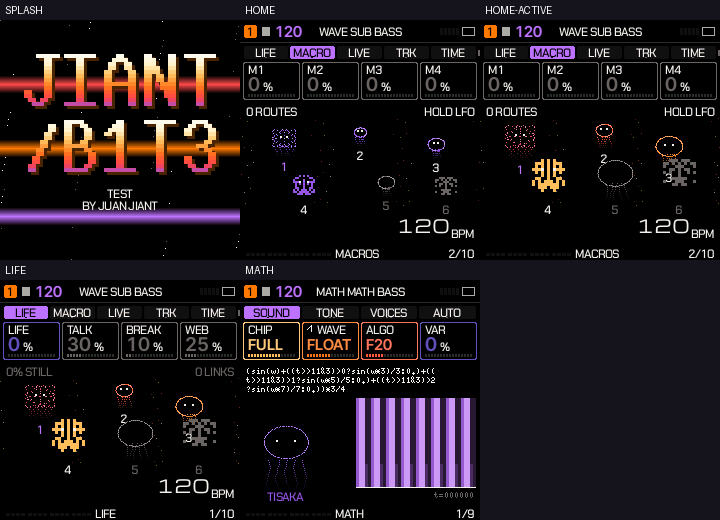

<!-- SPDX-License-Identifier: GPL-3.0-only -->
# JIANT /B1T3: revisión de diseño y generador

Revisión del 17 de noviembre de 2026 sobre `phase2-engines` (`a721b6c`).
Las imágenes son capturas del código C del firmware ejecutado con el simulador de pantalla de las pruebas;
no son maquetas ni capturas de un FM-1 físico. `TEST` es la versión del ejecutable de pruebas.

## Cambios realizados

- Arranque **JIANT /B1T3**, con degradado de la escala térmica del sistema. El logo se regenera durante el build.
- Etiquetas Chakra Petch de 12 px, valores Inter Tight de 15/19 px y títulos Michroma. Las fórmulas conservan
  su fuente monoespaciada de 5×8, minúsculas y operadores. Se mantiene la estética pixel en gráficos y cajas.
- HOME recupera el movimiento libre original de JIANT FM, con estrellas y sin suelo. LIFE utiliza sus posiciones
  cuando su estado está inicializado; antes del primer bloque de audio conserva la distribución de HOME.
- Los seres usan la escala violeta → rojo → naranja → crema según el nivel. Se corrigió la división por 256 que
  convertía el nivel de HOME, ya expresado en 0…256, en casi cero. Los números acompañan a cada ser y se separan
  cuando se cruzan; el tempo ocupa el borde inferior. Los silencios no se representan como actividad intensa.
- El generador deja de interpretar índices de presets y parámetros de ANALOG/FM6/VOICE como si fueran MATH/WAVE.
  Ahora usa recetas nativas por rol. Conserva los algoritmos, relojes y loops tonales de MATH, controla CAOS en
  texturas y elimina los ajustes de ganancia heredados de los motores retirados. EXPLORE también elige motores reales.

## Auditoría de personajes

| Aspecto | Hallazgo y resultado |
|---|---|
| Identidad BYTE | El cuerpo cambiaba con cada muestra temporal. Ahora las posiciones de muestreo son fijas: la fórmula determina el cuerpo y las patas dan movimiento. Cambiar la fórmula puede cambiar el ser; no se garantiza una identidad única para cada fórmula. |
| Identidad FLOAT | Se conserva el retrato de fase y los tentáculos. La silueta distingue esta familia de los sprites de bits. |
| Reacción musical | Corregida la escala del nivel en HOME. Color, movimiento y tamaño responden al sonido; el tamaño está limitado para dejar espacio a las seis pistas. |
| Espacio | Eliminada la sustitución que forzaba seis posiciones sobre un horizonte. Se reutilizan la física y el reloj de animación existentes. |
| Lectura | Número de pista junto al ser, sin solapamientos de etiquetas en el barrido de pruebas; el seleccionado conserva su énfasis. Silenciados y pistas inactivas aparecen atenuados. |
| WAVE | El retrato sigue representando la fórmula A, no el resultado completo de A/B, WARP y MIX. Pendiente para una representación exacta de su timbre final. |
| DRUM | El panel KIT conserva los ocho seres y su respuesta al golpe. HOME usa un representante abstracto por pista; todavía no resume todas las fórmulas del kit. |
| Similitud | Fórmulas FLOAT parecidas pueden producir siluetas similares. Conviene revisar su diferenciación con escucha y sesiones reales antes de ampliar familias. |

## Qué motores utiliza GEN

| Rol | WAVE | MATH |
|---|---|---|
| Bajo | SUB BASS | MATH BASS |
| Acordes/pad | SAW PAD, FORMANT, FM KEYS | MATH PAD, FLOAT PAD, MATH KEYS |
| Melodía | SYNC LEAD, FM KEYS, FM BELL | MATH LEAD, BYTE TONE, MATH KEYS |
| Arpegio | FM KEYS, FM BELL, SYNC LEAD | MATH BELL, MATH KEYS, MATH LEAD |
| Textura | BIT TABLE, FORMANT, SAW PAD | BYTEBEAT, BYTE VAR, BYTE BENT |

DRUM-X sigue siendo la batería. La armonía, los patrones, la forma, los sobres y la mezcla siguen respondiendo
al género. **FM-F, GLITCH, PLUCK y NOISE no están implementados en esta rama y no se anuncian como disponibles.**
No se cambian los formatos de proyectos ni los identificadores persistidos de los motores.

## Verificación y límites

- `tests/run_byte_tests.sh`: pruebas de FVM, MATH, WAVE, LIFE, generador, reproducción/guardado de canciones y fuentes.
- La prueba nueva genera 87 canciones (todos los géneros, RANDOM y EXPLORE, tres semillas): motores disponibles,
  rangos de parámetros, conservación de algoritmo, determinismo tras otras ediciones y variación entre semillas.
  En ese barrido aparecen 84 pistas BYTE y 138 FLOAT.
- Capturas revisadas: arranque, HOME en reposo/activo, LIFE y MATH. El barrido de UI cubre 391 pantallas en ocho paletas
  y los valores de los controles. Las desalineaciones de texto de un píxel o más de la base desaparecen.
- El informe global de UI **no pasa completamente**: persisten recortes de nombres largos de géneros y una
  superposición en el pie del generador, además de avisos de contraste heredados en capas de SONG/REC. La comparación
  con la base conserva los mismos 84 avisos de contraste. No se presentan como problemas resueltos.
- Compilación real JieLi/pi32v2 con el SDK AC79 fijado en `d179b448`: aplicación de 536252 B, con 48084 B
  libres en su partición; paquete `.fwsc` de 677404 B, identidad `FM-1_909`. Pasan las comprobaciones de memoria,
  llamadas y ubicación de código/tablas de audio. Las nuevas fuentes, logo y tablas del generador se ubican con
  los datos de interfaz; no se desactiva ni se regenera la protección del layout de audio.
- Emscripten 6.0.11: arranque, teclas, MIDI, secuenciador, guardado/restauración y audio determinista pasan.
  Una escena de WAVE, FLOAT, BYTE y DRUM coincide con el ejecutable nativo en sus 88200 muestras estéreo.
- Chromium: el emulador inicia sin errores JavaScript; el instalador carga el paquete real y comprueba SHA-256;
  una descarga alterada deja el botón de instalación desactivado. Capturas: [emulador](ui-byte/review/emulator-browser.png)
  e [instalador](ui-byte/review/installer-browser.png).
- No se ha flasheado ni medido la CPU de un FM-1 físico. Las suites heredadas de motores retirados (VOICE, WEST)
  requieren mantenimiento aparte; no se afirma que toda la batería histórica pase.

El emulador y el instalador principal se publican juntos desde el mismo commit. La etiqueta es de desarrollo,
no de validación física. El índice conserva versiones anteriores cuando están disponibles. `web/STABLE` es una
referencia histórica y este flujo de publicación directa ya no la utiliza.
