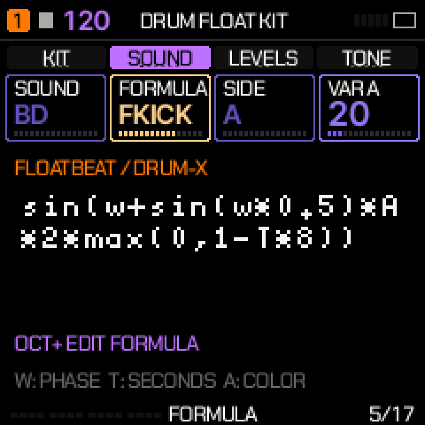
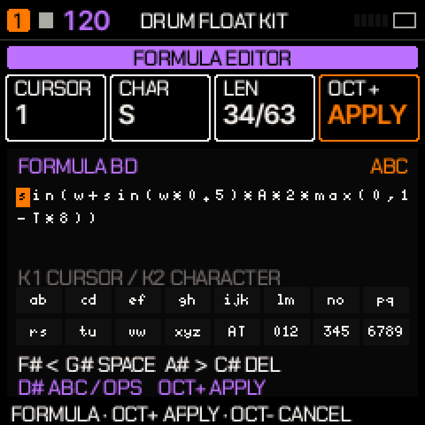
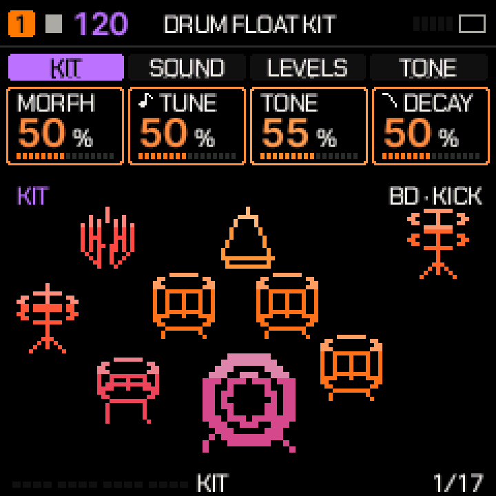

# JIANT /B1T3 — BYTE v0.4

## LIFE: recorrido musical y extremo

GEN sigue empezando con **LIFE 0**. El control principal tiene una curva progresiva tipo potenciómetro de audio:

| LIFE | Profundidad efectiva |
|---|---|
| 0 | 0%: bypass exacto |
| 25 | 4% |
| 50 | 19% |
| 75 | 49% |
| 100 | 100% |

La zona baja/media permite ajustar con precisión; el extremo queda al final. No se aplica un logaritmo directo
que concentraría el cambio al principio, sino una aproximación convexa en enteros. **PULSE** puede llegar a
bombeo profundo (hasta 90% entre pulsos), **COLOR** a filtrado completo y **LINK** a una interacción de hasta
50% de atenuación por las otras pistas. Las ganancias se combinan multiplicándose, sin amplificar ni alterar
la fase, el reloj de las fórmulas, las notas o CAOS. LINK ya no diluye su efecto con pistas silenciosas.

PULSE/COLOR/LINK iniciales: **65/60/40**. Para explorar: LIFE 50, luego 75–85; para el extremo, subir también
los tres controles. COLOR recorre dos compases. Los cambios de profundidad se suavizan.

[Comparación de la misma canción a cuatro intensidades](https://juanjiant-bit.github.io/JIANT-BYTE/emu/life-demo/).
Las cuatro tomas usan el mismo código y los mismos niveles, sin normalizar cada una.

## DrumX: fórmulas editables y batería pixel

**EDIT → SOUND → FORMULA** muestra la expresión completa al doble de tamaño. K1 elige el instrumento;
K2 selecciona una fórmula de fábrica o USER; K3 elige el lado A/B de COLOR; K4 modifica A.

**OCT+** abre el editor del texto del instrumento seleccionado:

- **K1:** cursor. **K2:** cambia el carácter bajo el cursor.
- **Teclas blancas:** grupos de letras/dígitos, pulsaciones repetidas para elegir el carácter.
- **D#:** alterna letras y operadores. **F#/A#:** cursor izquierda/derecha.
- **G#:** inserta un espacio. **C#:** borra el carácter anterior.
- **OCT+:** valida y aplica. **OCT−:** cancela los cambios.

El mismo flujo funciona en el dispositivo y con sus controles virtuales en el emulador. Se pueden escribir
expresiones nuevas: por ejemplo `sin(w*2)` o `sin(w+sin(w*2)*A*3)`. `w` es la fase, `T` los segundos desde el golpe,
`t` el contador de la fórmula, `A` COLOR y `v` la velocidad. Los nombres y variables distinguen mayúsculas.

Cada instrumento conserva hasta **63 caracteres**, **24 instrucciones de VM** y **2 estados**. Una expresión
inválida muestra el error y su posición, mantiene abierto el editor y deja intacto el sonido anterior. La edición
se prepara antes de publicarse al audio. No hay ejecución de código externo ni evaluación JavaScript.

Los textos USER, selección de fórmula y RATE/BEND/BITS se guardan con la sección; también se aplican al
recorrer un arreglo. Los proyectos sin texto USER siguen leyendo sus fórmulas de fábrica. FLOAT KIT restablece
sus ocho fórmulas y modificadores. Las fórmulas pertenecen al instrumento; A/B sigue siendo la pareja de patches
que mezcla MORPH, no dos textos distintos.

La batería recupera la disposición del JIANT FM original: bombo central, caja lateral, toms, hi-hats sobre
soportes, campana, palmas y rim. Sus siluetas son píxeles térmicos y reaccionan al golpe.

## Voces y CPU

En **EDIT → VOICES**, **K2 VOICES** limita cada pista a **1–8 voces**, para WAVE, MATH y DRUM-X. La pantalla
muestra cuántas están activas y el máximo. MONO/LEG siguen usando una sola; UNISON respeta el límite elegido.
Los límites generales del motor y LOAD/ECO siguen teniendo prioridad.

Al reducir el número, las voces sobrantes terminan con el fundido existente de unos 6 ms; después ya no se
sintetizan. Las notas nuevas reutilizan o roban voces dentro del límite. Se guarda con el proyecto y sus secciones.
Los cambios realizados mientras suena un arreglo se mantienen como una edición del sonido. **GL MODE** se
encuentra ahora en **VOICES 3**; los demás controles siguen disponibles.

## MY LOOP: conservar A y construir la canción

**GEN → FORM: MY LOOP → OCT+** captura primero el loop original como **A**, incluidos los tracks vacíos,
sonidos, fórmulas de DrumX, notas, velocidades, gates, swing y automatización. GEN mantiene LIFE 0.

Las partes nuevas y variaciones se construyen en **B/C/D**. El loop actual vuelve a A al terminar; **PLAY**
reproduce el arreglo completo en modo SONG. A queda disponible intacta dentro de la canción; las partes añadidas
no se inyectan en el original. La misma entrada y semilla producen el mismo arreglo. SAVE permite guardar la
canción con sus secciones. Si una sección no cabe, se informa el fallo y se conserva el loop; ya no se presenta
un resultado incompleto como una canción generada correctamente.

## Verificación

Pruebas de audio y bypass de LIFE, curva monótona y extremos, sincronía de pulso, edición y validación de
fórmulas, persistencia de ocho textos, límites de voces y retirada suave, original MY LOOP intacto, arreglo,
guardado y reproducción de secciones. Comparación nativa/WebAssembly con fórmula USER y LIFE al máximo;
compilación real del firmware con las comprobaciones de memoria y mapa de audio activas.

Esta revisión se valida en emulación y compilación; queda pendiente la prueba en hardware físico.
