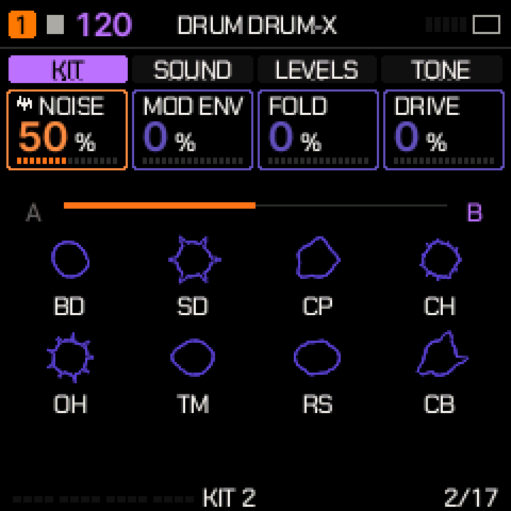
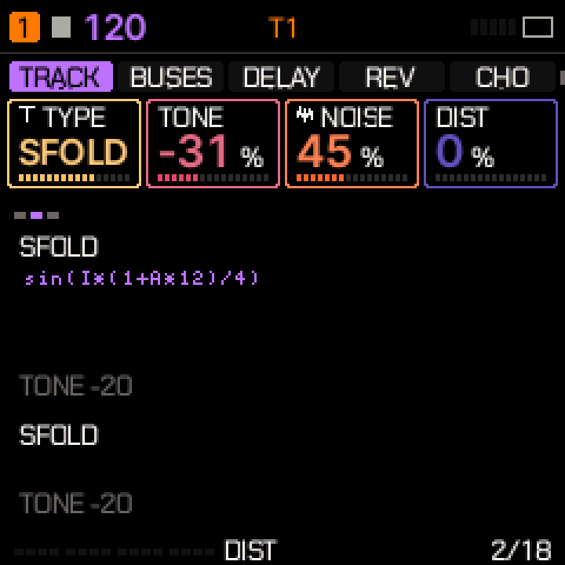
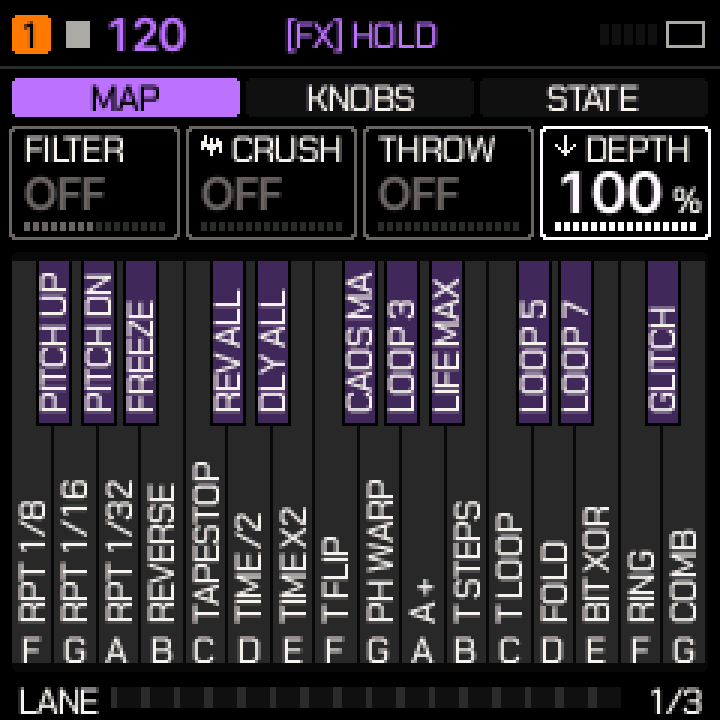

# JIANT /B1T3 — BYTE v0.5

## DrumX: FOLD y MOD ENV vuelven a actuar

En **EDIT → KIT → KIT 2**, **MOD ENV (K2)** modula la fase de la fórmula con la envolvente del golpe:
la pegada se vuelve más metálica y la cola vuelve a su timbre. **FOLD (K3)** pliega la señal después de la
envolvente, igual que en el oscilador clásico. Ambos funcionan con FLOAT KIT y fórmulas USER; a cero no añaden
ninguna transformación. La modulación no reescribe la fórmula ni cambia su reloj base.

Estos controles actúan sobre el componente de oscilador: una capa compuesta exclusivamente de ruido no tiene
oscilador que plegar. COLOR, ruido, pitch envelope, RATE/BEND/BITS y la envolvente de volumen conservan su función.

## DIST: distorsiones y controles efectivos

El selector ofrece **SOFT, HARD, FOLD, RECT, AMP, STEPS, XOR, SFOLD y SAT**. Los filtros LPF/LFO.F/HPF y los
efectos de volumen/ring aleatorios salen del selector. El filtrado de pista sigue en **EDIT → TONE → FILTER**.
Los valores antiguos pueden seguir sonando al cargar un proyecto, pero no aparecen al recorrer TYPE.

**TONE** procesa también las distorsiones por fórmula, y **NOISE** ya no queda omitido por su ruta de audio.
Ambos se han comprobado en cada distorsión seleccionable y en los filtros antiguos. **DRIVE/DIST debe estar
por encima de cero** (ahora también en **K4 de DIST**): con el efecto apagado, TONE y NOISE también quedan fuera de la señal.

## Punch-in: operadores de fórmulas

Mantener **FX** abre el mapa de efectos. En esa capa, el banco blanco **D4–F5** transforma momentáneamente las fórmulas de WAVE, MATH y los
instrumentos por fórmula de DRUM-X. Presionar entra en la siguiente semicorchea cuando PLAY está activo;
soltar sale inmediatamente. Con el transporte parado la entrada es inmediata. Esta fila es momentánea incluso
con FX LATCH activado. Los efectos de buffer y ambiente de las otras teclas siguen disponibles.

| Tecla | Pantalla | Operación |
|---|---|---|
| D4 | TIME /2 | La fórmula lee sus tiempos a la mitad. |
| E4 | TIME x2 | Lee los tiempos al doble. |
| F4 | T FLIP | Invierte un grupo de bits de tiempo/fase. |
| G4 | PH WARP | Deforma de forma sinusoidal el tiempo/fase leído. |
| A4 | A + | Desplaza el operando A, con vuelta dentro de su rango. |
| B4 | T STEPS | Cuantiza el tiempo/fase en escalones. |
| C5 | T LOOP | Limita la lectura a una ventana corta repetida. |
| D5 | FOLD | Pliega la salida de la fórmula. |
| E5 | BIT XOR | Aplica XOR a los bits de salida. |
| F5 | RING | Multiplica la salida por un seno derivado de su fase/tiempo. |

La expresión, los parámetros y el reloj original siguen intactos. Al soltar se vuelve a leer el tiempo que
corresponde a ese instante, sin reiniciar la voz. Guardar mientras se pulsa no incorpora el operador al patch.
Las fórmulas con estados internos pueden conservar su cola normal; no queda ningún operador activado.

El efecto depende de qué variables usa cada fórmula: **A +** necesita que la expresión lea A; una constante
sin tiempo ni fase no cambia al transformar esas entradas. Las fórmulas de fase periódica interpretan TIME
como una transformación de su lectura, no como una transposición universal. El oscilador clásico de DrumX
no es una fórmula y conserva sus controles de KIT.

La pista de punch-in sigue pudiendo grabarse y reproducirse: sus diez posiciones ahora representan estos
operadores. Las grabaciones antiguas de ese banco adoptan los nuevos significados.

## GEN: familias de fórmulas por función musical

GEN conserva las estructuras, armonía y ritmos de cada género, pero ahora diseña el timbre por función:

- **Bajo:** familias floatbeat de fundamental y parciales enteros, o WAVE con subgrave; sin CAOS ni BEND aleatorios.
- **Pads y lead:** familias floatbeat armónicas/FM y WAVE con POS, mezcla y anchura controladas.
- **Arpegios y texturas:** familias bytebeat con VAR propio, niveles moderados y evolución sincronizada al tempo;
  los arpegios de géneros más orgánicos usan bytebeat con menor frecuencia.
- **DrumX:** FLOAT KIT adaptado al género, con BEND/BITS dosificados según ENERGY/COMPLEX.

El generador ya no limita ALGO al del preset de partida. Elige entre familias curadas y conserva su identidad
entre secciones. **B/C/D** desarrollan el timbre mediante automatización de POS en WAVE, BEND en BYTE y filtro
en FLOAT tonal; la evolución interna de las fórmulas sigue el tempo. No selecciona otra fórmula al azar en
mitad de una nota. ENERGY y COMPLEX regulan profundidad y densidad.

**GEN sigue dejando LIFE en 0. MY LOOP conserva el original exacto en A** y construye las nuevas partes alrededor.
La semilla y el loop de entrada siguen determinando el resultado. VOICES 1–8, el editor de fórmulas y la batería
pixel de v0.4 se conservan.

## Verificación

`tests/byte_controls_test.c` compara audio real de FOLD/MOD ENV y TONE/NOISE por modo; verifica los diez
operadores en BYTE y FLOAT, las tres engines renderizadas, fase continua, press/release con LATCH, grabación,
parada y SAVE sin mutación. La suite BYTE añade regresiones de motores, LIFE, 87 canciones/géneros,
MY LOOP original intacto y determinista, persistencia, editor y límite de voces.

La comparación nativa/WebAssembly utiliza un arreglo con fórmula USER, MOD ENV, FOLD, distorsión con TONE/NOISE,
punch-in de fase/fold y LIFE al máximo. Firmware AC79 real, con guards de memoria y mapa de audio activos.
La validación física en el dispositivo sigue pendiente.
