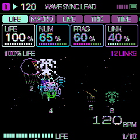

# BYTE v0.6 — FUGA y LIFE entre fórmulas

En **GEN → FUGA → SONG**, la primera voz ahora entra también con cuatro pistas. El generador reservaba un canal de batería incluso en géneros sin batería; esa reserva podía colocar el sujeto inicial fuera de las pistas activas. FUGA conserva su estructura y el generador sigue dejando **LIFE en 0**.

En **HOME → LIFE**, los cuatro encoders controlan:

| Control | Qué hace |
|---|---|
| LIFE | Profundidad global. 0 es bypass exacto. La curva conserva un recorrido amplio: 50 equivale aproximadamente al 19% de profundidad, 75 al 49%, 100 al máximo. |
| NUM (NUMBERS) | Intercambia constantes numéricas entre fórmulas que están sonando. Acerca un literal de la fórmula receptora al promedio de los donantes activos, ponderado por su envolvente. |
| FRAG (FRAGMENTS) | Toma subexpresiones compiladas de todas las otras voces elegibles, las ejecuta con las variables de la nota receptora y mezcla sus resultados dentro de un operando de tiempo/fase de su fórmula. |
| LINK | Usa la señal de las otras fórmulas para modular ese operando de tiempo/fase. Es modulación dentro de la expresión, no una mezcla añadida a su salida. |

Valores iniciales de carácter: **65 / 60 / 40**; no actúan hasta subir LIFE. Probar con dos notas o motores superpuestos, LIFE entre 30 y 60, y luego acercarlo a 100 para el extremo. También se conectan dos notas polifónicas de la misma pista. El control LIFE de cada pista reduce su recepción; a 0 la excluye también como donante.

BYTE, FLOAT, WAVE y las voces de **DRUM-X con FORMULA activada** participan. La red es bidireccional: WAVE↔MATH, WAVE↔DRUM-X y MATH↔DRUM-X, sin un motor central ni parejas fijas. Las voces clásicas de batería no tienen fragmentos: donan COLOR y su señal, y reciben NUM/LINK mediante un COLOR temporal que modifica su timbre sin cambiar el patch. Las contribuciones siguen las envolventes de las notas; DRUM-X añade la caída real del golpe. Mute, solo y voces terminadas dejan de contribuir. Con una sola voz no hay otra fórmula con la que intercambiar.

Las fórmulas originales y los presets no se reescriben. Los tres valores antiguos de LIFE pasan a controlar NUMBERS / FRAGMENTS / LINK; el formato de guardado se mantiene, pero no se reproduce el comportamiento antiguo de PULSE/COLOR.

## Límites deliberados

El fragmento es un prefijo de bytecode que constituye una expresión completa, de hasta **8 instrucciones**. Se excluyen operaciones con estado (`ph`, `lp`, `hp`), tablas y lecturas de otras pistas. Se reparten **64 instrucciones adicionales** equitativamente entre todos los donantes elegibles, acortando cada fragmento a una subexpresión completa cuando hace falta. Ninguna voz se excluye por su posición. Sumado al programa receptor, el máximo es **128 instrucciones por evaluación**, además de la suma normalizada de contribuciones. Las conversiones BYTE/FLOAT respetan INT/FIX. Los literales intercambiables son positivos y de hasta 32; algunas fórmulas no tienen un literal o entrada elegible y, por ello, no responden a todos los controles.

La VM ejecuta el fragmento sin volver a compilar, sin asignación dinámica y sin alterar el reloj acumulado del instrumento ni el secuenciador. Dos bancos de muestras/metadatos hacen que cada voz lea el bloque anterior: cambiar el orden de render o el núcleo no cambia los resultados. Las fórmulas con feedback pueden producir timbres extremos; LIFE es deliberadamente más intenso cerca del máximo.

## Verificación

- FUGA: cuatro y seis pistas, dos semillas, intro audible, las siete secciones con audio y retorno al inicio.
- LIFE: bypass exacto; tres controles con cambios de señal; cambiar el fragmento donante cambia el receptor aun sin señal de audio donante; INT→FIX y FIX→INT; orden de render inverso idéntico; mute/inactividad/solo; instrucciones originales intactas; las seis direcciones entre WAVE/MATH/DRUM-X; tres motores simultáneos con cada donante comprobado por separado y solo FRAG activo; NUM/LINK bidireccional con batería clásica; valores intermedios de los tres controles; notas del mismo motor; avance del oscilador idéntico.
- Regresión de VM, motores, generador, MY LOOP, VOICES, edición DRUM-X y controles momentáneos.
- Audio nativo/WASM idéntico en 88.200 frames de una canción con BYTE, FLOAT, WAVE y FLOAT KIT, LIFE al máximo. Benchmark local de WASM: aproximadamente 43 ms por segundo de audio; **no es una medición de CPU del instrumento**.
- Build real del firmware con sus comprobaciones de memoria y de instrucciones. Falta escucha y medición de carga en el dispositivo físico.

Comparación reproducible con `tests/life_demo.c`, mismos ocho segundos y mismas notas, controles 65/60/40: [LIFE 0](https://juanjiant-bit.github.io/JIANT-BYTE/audio/v06/life-0.wav), [LIFE 50](https://juanjiant-bit.github.io/JIANT-BYTE/audio/v06/life-50.wav), [LIFE 100](https://juanjiant-bit.github.io/JIANT-BYTE/audio/v06/life-100.wav).

El emulador y el instalador publican v0.6. La app Android conserva su APK y obtiene el nuevo motor BYTE mediante su actualización de emuladores; los perfiles Jiant FM no cambian.
