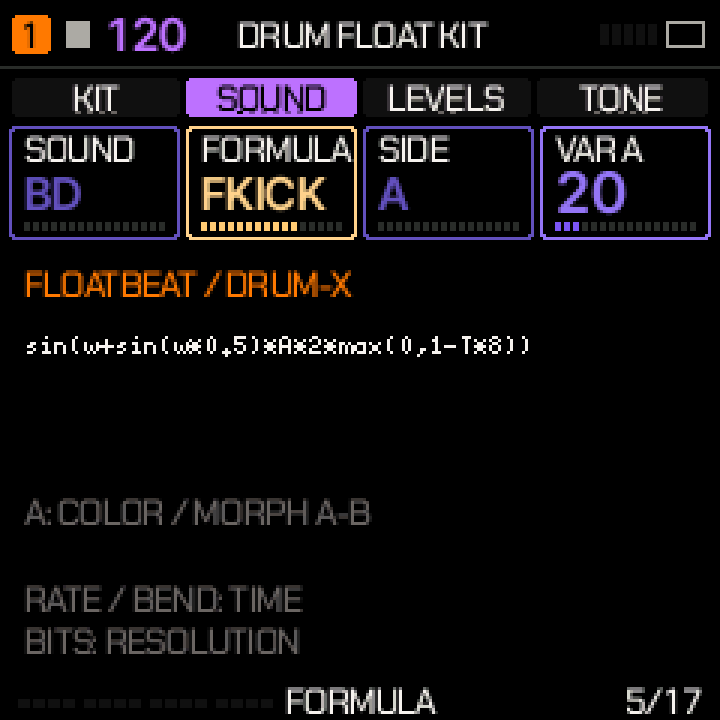
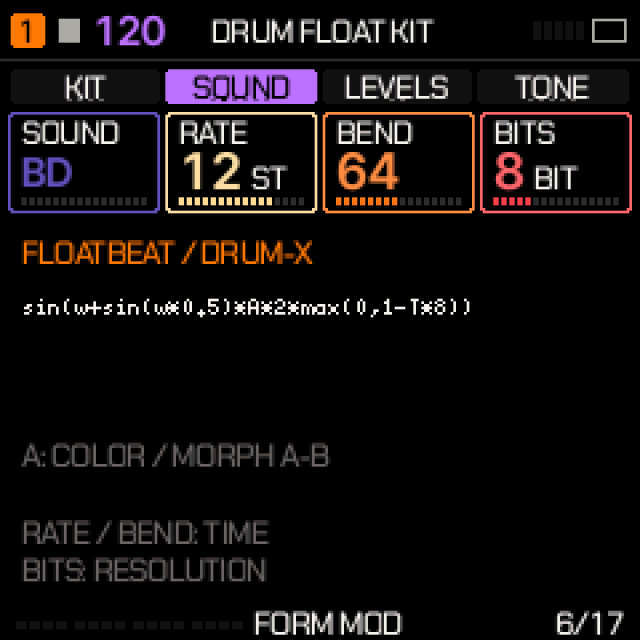

# DRUM-X Floatbeat — BYTE v0.2

DRUM-X dispone de un preset **FLOAT KIT**, con ocho instrumentos generados por fórmulas: bombo, caja,
palmas, hi-hat cerrado/abierto, tom, rim y cencerro. Las fórmulas usan la máquina virtual acotada existente;
no ejecutan código externo. Esta versión ofrece 24 fórmulas seleccionables, con sus expresiones visibles.

## Cómo tocarlo

1. Selecciona la pista DRUM y gira **PRESETS** hasta **FLOAT KIT** (después de LATIN PERC).
2. En **EDIT → SOUND → FORMULA**, usa los cuatro controles:
   - **SOUND**: instrumento BD, SD, CP, CH, OH, TM, RS o CB.
   - **FORMULA**: CLASSIC, o una de las 24 fórmulas. CLASSIC usa el oscilador DRUM-X habitual.
   - **SIDE**: parche A/B; MORPH mezcla ambos.
   - **VAR A**: variable `A` de la expresión, compartida con COLOR de SOUND 2. Actúa en las fórmulas que usan `A`.
3. En **FORM MOD**, los controles son **SOUND**, **RATE**, **BEND** y **BITS**:

| Control | Rango | Efecto | Neutro |
|---|---|---|---|
| RATE | −24…+24 semitonos | Escala el reloj de la fórmula entre ¼× y 4× | 0 |
| BEND | 0…127 | Deforma la fase con una curva sinusoidal | 0 |
| BITS | 16…4 bits | Cuantiza la salida de la fórmula antes de su envolvente | 16 |

Los modificadores pertenecen al instrumento del kit; el kit se comparte entre las pistas DRUM de la sección.
Se guardan con proyectos, secciones y la recuperación de sonidos de un proyecto. La selección del preset
FLOAT KIT inicializa sus fórmulas y modificadores. Los presets anteriores conservan su comportamiento.
SOUND 2 mantiene DECAY y NOISE, para mezclar la fórmula con ruido; FLOAT KIT comienza con NOISE a cero.

El generador restaura las fórmulas percusivas de fábrica y los modificadores neutros al crear un kit: una edición
previa no contamina la reproducción de una semilla. Las fórmulas y sus identificadores anteriores no cambian.
Un proyecto sin la nueva extensión DQ carga RATE/BEND a cero y BITS a 16; CLASSIC ignora estos modificadores.

## Verificación

- `tests/run_byte_tests.sh`: FVM, BYTE, WAVE, LIFE, generador, canciones, fórmulas DRUM-X y fuentes.
- Ocho instrumentos de FLOAT KIT: audio presente y acotado, cambios audibles en cada modificador y repetición
  determinista desde el mismo estado. Guardado/lectura DQ, importación sin DQ y límites de los controles.
- Comparación con BYTE v0.1: 352800 muestras de los ocho instrumentos clásicos y las ocho fórmulas de fábrica
  permanecen idénticas con modificadores neutros.
- Emscripten 6.0.11: 88200 muestras de WAVE/FLOAT/BYTE y FLOAT KIT con RATE/BEND/BITS activos coinciden con el
  ejecutable nativo; pasan arranque, MIDI, reproducción y guardado del emulador.
- Firmware JieLi/pi32v2 real: 537936 B de aplicación, 46400 B libres en la partición. El mapa de audio se actualizó
  porque cambió el DSP; una segunda compilación normal comprueba sus direcciones y todos los límites de memoria.
- No se ha flasheado ni medido el rendimiento en un FM-1 físico.
