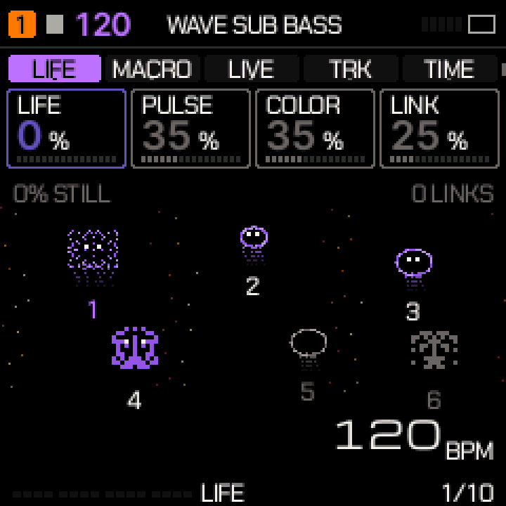
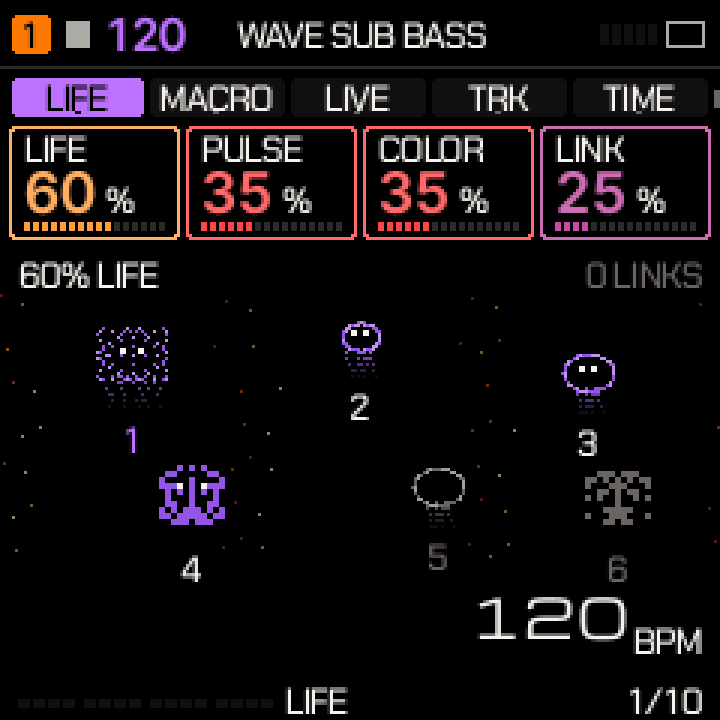

# LIFE musical — BYTE v0.3

GEN empieza con **LIFE en 0** en LOOP, PARTS, SONG y FROM LOOP. También es el valor inicial de un proyecto nuevo.
En **HOME → LIFE**, el primer control activa gradualmente la modulación; los otros tres preparan su carácter.

| Control | Comportamiento |
|---|---|
| LIFE | Profundidad global lineal, 0–100. A 0, el audio pasa sin cambios. |
| PULSE | Respiración de volumen sincronizada con cada negra. El pulso recupera el nivel completo en los tiempos; entre ellos baja hasta aproximadamente un 12% a profundidad máxima. |
| COLOR | Movimiento suave de brillo en un ciclo de cuatro compases. Mezcla hasta un 25% de filtro pasa-bajos paralelo, sin resonancia. |
| LINK | Interacción mediante las envolventes de las otras pistas. Atenúa hasta aproximadamente un 8%; la batería pesa más y la normalización evita que más pistas multipliquen la intensidad. |

PULSE, COLOR y LINK comienzan en 35, 35 y 25, pero no actúan hasta subir LIFE. Un punto de partida es LIFE 30–50.
El control LIFE de cada pista permite excluirla o reducir su participación. Los seres siguen moviéndose en HOME.

La modulación se aplica después de sintetizar la pista y antes de sus efectos. No modifica la fase de los
osciladores, el reloj de las fórmulas, las notas, CAOS ni los envíos de efectos. Los cambios de profundidad se
suavizan y los canales estéreo comparten la misma curva. La matriz explícita de modulación sigue disponible.

Se conserva el formato de los cuatro valores guardados; los antiguos TALK/BREAK/WEB pasan a controlar
PULSE/COLOR/LINK. No se conserva el sonido destructivo anterior ni se añade un modo legacy.

## Verificación

- Bypass exacto con LIFE o participación de pista en cero; controles independientes y combinación máxima.
- PULSE sincronizado a 60, 120 y 180 BPM; LINK mantiene su profundidad al aumentar las fuentes.
- Estado de osciladores/fórmulas idéntico con LIFE apagado y activo; imagen estéreo coherente.
- En una señal de prueba de dos tonos, los tres controles al máximo mantienen el 92,37% del RMS original
  y una correlación de 0,9982. Es una comprobación acotada, no una garantía de nivel para cualquier sonido.
- Generación de 87 canciones y comprobación de LIFE cero en las cuatro formas; guardado de secciones y
  coexistencia con los bloques de modificadores de FLOAT KIT. Pruebas FVM, BYTE, WAVE, DRUM-X y fuentes.
- Emulador WebAssembly comparado con el ejecutable nativo con LIFE y los modificadores de FLOAT KIT activos.
- Firmware real JieLi/pi32v2: aplicación de 535840 B, 48496 B libres; comprobaciones del mapa de audio y memoria.

Validado por compilación y emulación. Esta revisión no se ha probado todavía en el dispositivo físico.
